# JavaScript quickstart - Essential notes by Renato Lins

JavaScript was initially created by Brendan Eich in 1995 for Netscape with the specific purpose of enabling scripting capabilities in web browsers. The intention was to develop a scripting language that could be executed by browsers to enhance the interactivity of websites. Since then, JavaScript has evolved to become a versatile and widely-used programming language, not only for client-side scripting in browsers but also for server-side development and a variety of other applications.

__JavaScript and ECMAScript:__ The language is standardized under the name __ECMAScript__ (often abbreviated as __ES__). When you read terms like "ES6" or "ES2015" in this tutorial, they refer to versions of that standard. ES6 (also called ES2015) was a huge update that introduced many of the features used throughout this tutorial, and since then a new version has been released every year (ES2016, ES2017, and so on).

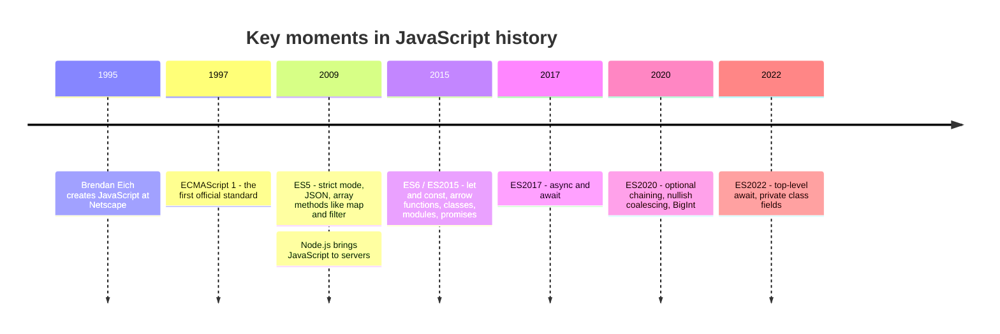

## Table of Contents

- [1. Considerations: Why to learn JavaScript](#1-considerations-why-to-learn-javascript)
- [2. Variables](#2-variables)
- [3. Data types](#3-data-types)
- [4. Type conversion](#4-type-conversion)
- [5. Operators](#5-operators)
- [6. Control flow I - 'if' statement](#6-control-flow-i---if-statement)
- [7. Control Flow II - Falsy and Truthy Values](#7-control-flow-ii---falsy-and-truthy-values)
- [8. Control flow III - Loops](#8-control-flow-iii---loops)
- [9. Control flow IV - switch-case statements](#9-control-flow-iv---switch-case-statements)
- [10. Basics of functions](#10-basics-of-functions)
- [11. String Manipulation & Formatting](#11-string-manipulation--formatting)
- [12. Scope I: Types of Scope and Hoisting in JavaScript](#12-scope-i-types-of-scope-and-hoisting-in-javascript)
- [13. Scope II: Dealing with var, let and const](#13-scope-ii-dealing-with-var-let-and-const)
- [14. Essential array methods (.map(), .find(), .filter(), .reduce())](#14-essential-array-methods-map-find-filter-reduce)
- [15. Built-In JavaScript mathematical features](#15-built-in-javascript-mathematical-features)
- [16. Objects and common object methods in JavaScript](#16-objects-and-common-object-methods-in-javascript)
- [17. A better understanding of null and undefined](#17-a-better-understanding-of-null-and-undefined)
- [18. JavaScript Naming Conventions](#18-javascript-naming-conventions)
- [19. The NaN Type](#19-the-nan-type)
- [20. Scope III: Closures, IIFEs and Best Practices](#20-scope-iii-closures-iifes-and-best-practices)
- [21. Scope IV: Context and `this` in JavaScript + Differences Between Regular and Arrow Functions](#21-scope-iv-context-and-this-in-javascript--differences-between-regular-and-arrow-functions)
- [22. Error Handling in JavaScript](#22-error-handling-in-javascript)
- [23. Strict mode](#23-strict-mode)
- [24. Associating JavaScript Code with an HTML Page](#24-associating-javascript-code-with-an-html-page)
- [25. Basic DOM Manipulation in JavaScript](#25-basic-dom-manipulation-in-javascript)
- [26. Understanding JavaScript Module Systems](#26-understanding-javascript-module-systems)
- [27. Understanding Promises, Async-Await, and Their Relationship to Functions](#27-understanding-promises-async-await-and-their-relationship-to-functions)
- [28. Declarative vs. Imperative Programming and Immutability in JavaScript](#28-declarative-vs-imperative-programming-and-immutability-in-javascript)
- [Proposed exercises and answers](#proposed-exercises-and-answers)
- [BONUS - Running JavaScript on your machine (using Node.js)](#bonus---running-javascript-on-your-machine-using-nodejs)

---

### 1. Considerations: Why to learn JavaScript

__Versatility Across Domains:__ JavaScript is a key player in web development, handling tasks for both front-end and back-end operations with ease. Its versatility isn't limited to the web—it's also a popular choice for mobile apps, games, IoT projects, desktop applications, and beyond. This wide-ranging application underscores its universal appeal and practicality across different domains.

__Multi-Paradigm Language:__ JavaScript is a multi-paradigm language, accommodating both object-oriented and functional programming styles, providing flexibility for developers.

__Frameworks and Libraries:__ Robust frameworks and libraries like React, Angular, and Vue.js expedite development, particularly for crafting intricate user interfaces and Single Page Applications (SPAs).

__NPM Ecosystem:__ The Node Package Manager (NPM) hosts a rich ecosystem of open-source packages, providing developers with a treasure trove of tools and resources to accelerate development.

__Easy Start-Up:__ JavaScript is easy to get started with – all you need is a text editor and a browser, tools that are present on almost all computers.

__Productive Development Environment:__ JavaScript facilitates a productive development environment, allowing for rapid prototyping and efficient coding practices.

__Active Community and Job Opportunities:__ JavaScript's vibrant community offers support, tutorials, and a wealth of resources. Proficiency in JavaScript is in high demand, translating to a plethora of job opportunities in the tech industry.

Ps. If you're new to JavaScript and not familiar with coding environments, I recommend starting with __jsfiddle.net__ to write your initial lines of code. To observe your code in action, simply type it in the 'JavaScript' tab and click 'Run.' If you wish to view values outputted to the console (as demonstrated in future examples using the console.log command), press F12, and you'll find the output under the 'Console' tab. You can also type JavaScript directly into that 'Console' tab of any page, which is handy for quick experiments.

---

### 2. Variables

A variable is a named storage location in your computer's memory. Think of it as a labeled box where you can store and retrieve information. You create a variable in JavaScript using the ```var```, ```let```, or ```const``` keywords, followed by the variable name.

```javascript
// Example of declaring a variable using 'var'
var message;
message = "Hello, JavaScript!";

// Example of declaring and assigning a variable using 'let'
let number = 42;

// Example of declaring a constant variable using 'const'
const PI = 3.14;
```

Ps. The differences between ```var```, ```let```, and ```const``` will be discussed further once this tutorial has provided the necessary background. Until then, a good rule of thumb is: use ```const``` by default, use ```let``` when you need to reassign the variable later, and avoid ```var``` in modern code.

---

### 3. Data types

JavaScript has several data types, each serving a specific purpose. The main ones include:

__String:__ Represents text and is enclosed in single or double quotes.

```javascript
let greeting = "Hello, World!";
```

__Number:__ Represents numerical values, including integers and floating-point numbers.

```javascript
let age = 25;
```

__Boolean:__ Represents either true or false, often used for logical operations.

```javascript
let isCodingFun = true;
```

__Undefined and Null:__ Both represent the absence of a value. ```undefined``` is what JavaScript gives a variable that was declared but never assigned, while ```null``` is assigned on purpose to say "no value here" (see Section 17 for details).

```javascript
let notAssignedYet;          // undefined
let selectedItem = null;     // intentionally empty
```

__Array:__ Represents a sequentially ordered list of values, where the first value is assigned to position 0, the second to position 1, and so on. Technically, arrays are a special kind of object.

```javascript
let colors = ["red", "green", "blue"];
console.log(colors[0]) // Output: red
```

__Object:__ Represents a collection of key-value pairs.

```javascript
let person = {
  age: 30,
  name: "John",
  isStudent: false
};
```

By now, you don't have to delve into every data type nuance, but it's crucial to understand the separation in JavaScript. Primitive types (string, number, bigint, boolean, undefined, null, and symbol) are simple and unchangeable. Non-primitive (reference) types, such as objects, arrays, and functions, are a bit more complex in structure and can be created in various formats.

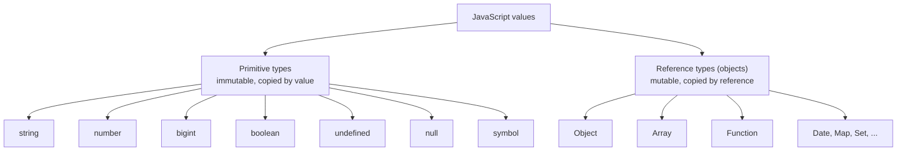

The "copied by value" vs. "copied by reference" difference matters as soon as you assign one variable to another:

```javascript
// Primitives are copied by value: each variable holds its own copy
let a = 10;
let b = a;
b = 20;
console.log(a); // 10 (unchanged)

// Objects and arrays are copied by reference: both variables point to the same array
const list1 = [1, 2];
const list2 = list1;
list2.push(3);
console.log(list1); // [1, 2, 3] (changed through list2!)
```

You can check the type of a value with the ```typeof``` operator, for example ```typeof "hello"``` returns ```"string"``` and ```typeof 42``` returns ```"number"```. Keep in mind that ```typeof []``` returns ```"object"```, so use ```Array.isArray()``` to check for arrays.

---

### 4. Type conversion

Type conversion in JavaScript refers to the process of converting a value from one data type to another. This can happen automatically (implicit conversion) or explicitly (when you manually convert a type).

__Implicit Type Conversion (Type Coercion):__ JavaScript automatically converts types during certain operations. This is called coercion.

- Example 1: Number to String: When using the `+` operator with a string and a number, JavaScript will convert the number to a string and then concatenate. Other arithmetic operators, such as `-`, go the other way and convert the string to a number.

```javascript
let result = "5" + 3;
console.log(result); // "53" (3 is converted to string "3")

let result2 = "5" - 3;
console.log(result2); // 2 ("5" is converted to number 5)
```

- Example 2: Boolean to Number: 
When performing arithmetic operations on booleans, JavaScript converts `true` to `1` and `false` to `0`.

```javascript
let result = true + 2;
console.log(result); // 3 (true is converted to 1)
```

__Explicit Type Conversion:__ You can manually convert data types using global JavaScript functions like `Number()`, `String()`, `Boolean()`, and `parseInt()`.

- Example 1: String to Number: You can explicitly convert a string to a number using the `Number()` function.

```javascript
let str = "123";
let num = Number(str);
console.log(num); // 123 (as a number)
```

- Example 2: Number to String: You can convert a number to a string using the `String()` function or `toString()` method.

```javascript
let num = 456;
let str = String(num);
console.log(str); // "456" (as a string)

let str2 = num.toString();
console.log(str2); // "456" (also as a string)
```

- Example 3: String to Boolean: Non-empty strings convert to `true`, and an empty string converts to `false`.

```javascript
let bool1 = Boolean("hello");
console.log(bool1); // true

let bool2 = Boolean("");
console.log(bool2); // false
```

- Example 4: Number to Boolean: Any non-zero number converts to `true`, while `0` converts to `false`.

```javascript
let bool1 = Boolean(1);
console.log(bool1); // true

let bool2 = Boolean(0);
console.log(bool2); // false
```

- Example 5: Parsing Integers and Floats: The `parseInt()` and `parseFloat()` functions are used to parse a string and return an integer or a floating-point number, respectively.

```javascript
let num1 = parseInt("123.45");
console.log(num1); // 123 (integer)

let num2 = parseFloat("123.45");
console.log(num2); // 123.45 (floating-point number)
```

---

### 5. Operators

Operators in JavaScript are powerful symbols that perform operations on variables and values. They allow you to create expressions, combining and manipulating data. Let's explore some fundamental operators with code examples:

__Assignment Operator (=):__ Assigns a value to a variable (as seen previously).

```javascript
let x = 10;
```

__Arithmetic Operators (`+`, `-`, `*`, `/`, `%`, `**`):__ Perform basic mathematical operations.

```javascript
let sum = 5 + 3;     // Calculate sum: 5 + 3 = 8
let difference = 7 - 2;  // Calculate difference: 7 - 2 = 5
let product = 4 * 6;     // Calculate product: 4 * 6 = 24
let quotient = 10 / 2;   // Calculate quotient: 10 / 2 = 5
let remainder = 15 % 4;  // Calculate remainder: 15 % 4 = 3
let power = 2 ** 3;      // Calculate exponentiation: 2 to the power of 3 = 8
```

__Compound Assignment Operators (`+=`, `-=`, `*=`, `/=`):__ Shorthand for updating a variable based on its current value.

```javascript
let total = 10;
total += 5;  // Same as: total = total + 5;  -> 15
total -= 3;  // Same as: total = total - 3;  -> 12
total *= 2;  // Same as: total = total * 2;  -> 24
total /= 4;  // Same as: total = total / 4;  -> 6
```

__Comparison Operators (==, ===, !=, !==, >, <, >=, <=):__ Compare values and return a Boolean result.

```javascript
/* Equality Operator (==): Compares values and performs an implicit conversion 
of data types if needed, which is called 'type coercion' */
let isEqual = (5 == '5');   // true, values are equal after type coercion

// Strict Equality Operator (===): Compares values and data types, no type coercion
let isStrictEqual = (5 === '5');  // false due to different data types

// Inequality Operator (!=): Compares values, performs type coercion if needed
let isNotEqual = (10 != '10');   // false, values are equal after type coercion

// Strict Inequality Operator (!==): Compares values and data types, no type coercion
let isNotStrictEqual = (10 !== '10');  // true, values are not equal due to different data types

// Greater Than Operator (>): Checks if the left operand is greater than the right operand
let isGreaterThan = (15 > 10);   // true, 15 is greater than 10

// Less Than Operator (<): Checks if the left operand is less than the right operand
let isLessThan = (5 < 8);       // true, 5 is less than 8

/* Greater Than or Equal To Operator (>=): Checks if the left operand is greater
than or equal to the right operand */
let isGreaterOrEqual = (20 >= 20);  // true, 20 is equal to 20

/* Less Than or Equal To Operator (<=): Checks if the left operand is less than or equal 
to the right operand */
let isLessOrEqual = (30 <= 25);     // false, 30 is not less than or equal to 25
```

With the knowledge we've gained so far, we can chain operators and variables to craft more elaborate comparisons:

```javascript
const x = 10;
const y = 15;
const z = 5;

// Chaining Comparison Operators
const isInRange = x < y && y > z;  // Evaluates to true if x is less than y and y is greater than z

// Another example
const isValid = x === 10 || (y < 20 && z >= 5);  
/* The expression above evaluates to true if x is exactly 10 or if y is less than 20 
and z is greater than or equal to 5 */
```

In both comparisons above, the expression will be evaluated to __true__.

Best Practice Tip: It's advisable to become accustomed to using strict equality and inequality operators (===, !==). These operators not only compare values but also consider data types, enhancing the robustness of our code.

__Logical Operators (&&, ||, !):__ Combine multiple conditions and perform logical comparisons to determine whether an expression is ```true``` or ```false```.

```javascript
// Logical AND (&&):
let isTrue = (true && false); // false

// Logical OR (||):
let isEitherTrue = (true || false); // true

// Logical NOT (!):
let isNotTrue = !true; // false
```

__Increment and Decrement Operators (++, --):__ Increment or decrement a variable by 1.

```javascript
let counter = 5;
counter++;     // Increment by 1
counter--;     // Decrement by 1
```

__String Concatenation Operator (+):__ Concatenates two or more strings.

```javascript
let firstName = 'John';
let lastName = 'Doe';
let fullName = firstName + ' ' + lastName;  // 'John Doe'
```

---

### 6. Control flow I - 'if' statement

In JavaScript, the ```if``` statement is used to conditionally execute a block of code. It allows you to specify a condition, and if that condition evaluates to true, the code inside the if block will be executed. If the condition is false, the code inside the if block will be skipped. Let's look at a simple example:

```javascript
let temperature = 25;

if (temperature > 20) {
  console.log("It's a warm day!");
}
```

In this example, if the temperature variable is greater than 20, the message "It's a warm day!" will be logged to the console. You can also use an else statement to specify a block of code that will be executed if the condition in the ```if``` statement is ```false```:

```javascript
let temperature = 25;

if (temperature > 20) {
  console.log("It's a warm day!");
} else {
  console.log("It's a cool day.");
}
```

In this case, if the temperature is not greater than 20, the message "It's a cool day." will be logged. You can also chain multiple conditions using ```else if```:

```javascript
let temperature = 25;

if (temperature > 30) {
  console.log("It's a hot day!");
} else if (temperature > 20) {
  console.log("It's a warm day!");
} else {
  console.log("It's a cool day.");
}
```

Here, if the temperature is greater than 30, the message "It's a hot day!" will be logged. If the temperature is not greater than 30 but is greater than 20, the message "It's a warm day!" will be logged. Otherwise, the message "It's a cool day." will be logged. The conditions are checked from top to bottom, and only the first block whose condition is ```true``` runs:

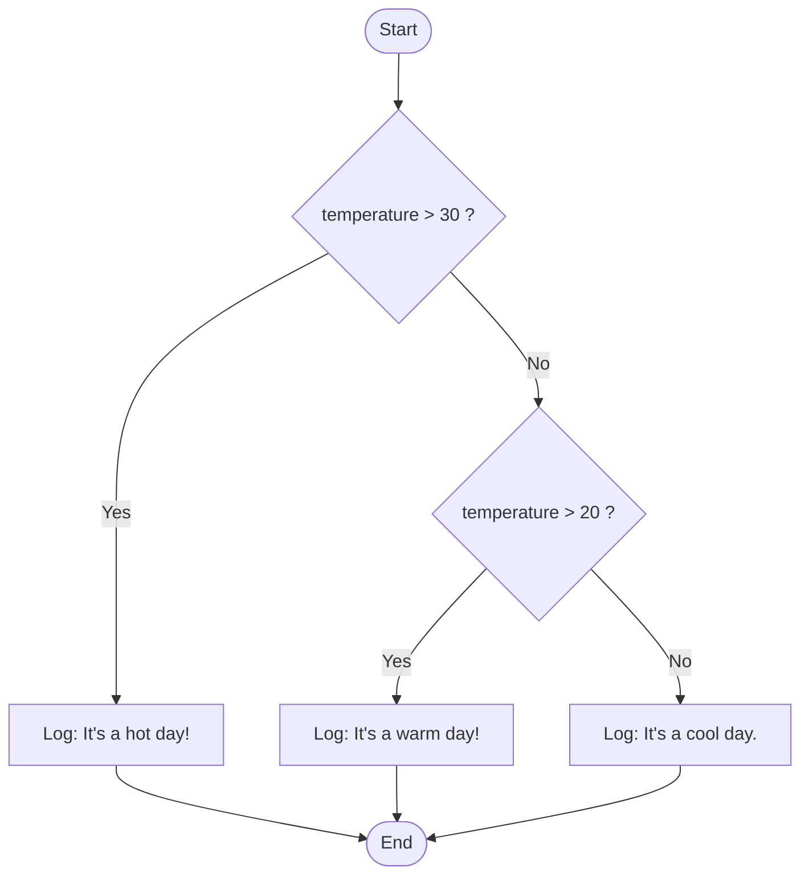

Ps. These are just basic examples, and ```if``` statements can become more complex with logical operators, ternary operators, and other JavaScript features.

__Ternary Operators__: In JavaScript, the ternary operator provides a concise way to write simple conditional statements. It's a shorthand for an if-else statement. The syntax is:

```javascript
condition ? expressionIfTrue : expressionIfFalse;
```

Here's an example to illustrate its usage:

```javascript
// Example 1: Using Ternary Operator for Assignment
let isSunny = true;
let activity = isSunny ? "Go for a walk" : "Stay indoors";

console.log(activity);  // Output: "Go for a walk"

let number = 15;
let parity = number % 2 === 0 ? "Even" : "Odd";

console.log(parity);  // Output: "Odd"
```

Chaining ternary operators for complex conditions is possible but may result in confusing code if not used carefully. Here's an example that may be considered readable by some and not by others:

```javascript
let age = 25;
let hasLicense = true;

let eligibility = age >= 18
  ? hasLicense
    ? "Allowed to drive"
    : "Cannot drive without a license"
  : "Too young to drive";
```

Explanation: The first ternary operator checks if the age is greater than or equal to 18. If ```true```, it proceeds to the next ternary operator, checking if hasLicense is true.
If both conditions are true, it assigns "Allowed to drive"; otherwise, it assigns "Cannot drive without a license". If the initial age condition is ```false```, it assigns "Too young to drive".

---

### 7. Control Flow II - Falsy and Truthy Values

In JavaScript, values can be broadly categorized into two groups: truthy and falsy.

__Truthy Values:__ A value is truthy if, when used in a condition (like in an if statement), it's treated as ```true```. For example, any non-empty string, any number other than 0, true, and any object are truthy. Be careful: this includes empty objects (```{}```) and empty arrays (```[]```), which are both truthy.

__Falsy Values:__ A value is falsy if, in a condition, it's treated as ```false```. The complete list is short: ```false```, ```0``` (and ```-0```), ```0n``` (BigInt zero), an empty string (```""```), ```null```, ```undefined```, and ```NaN``` (which stands for Not a Number). Every other value is truthy.

Here are two basic examples:

```javascript
if ("Hello") {
  // This code will run because "Hello" is truthy
  console.log("Truthy!");
}

if (0) {
  // This code won't run because 0 is falsy
  console.log("Falsy!");
}
```

__Default value:__ The "default value" or "fallback pattern" is a concise way to assign a default value to a variable if the initial value is falsy. The pattern typically involves using the logical OR (||) operator. Here's an example to illustrate the concept:

```javascript
// Example 1:
let myVar = "Hello, World!";
let message = myVar || "Default Value";

console.log(message);  // Output: "Hello, World!"

// Example 2:
let emptyVar = "";
let message2 = emptyVar || "Default Value";

console.log(message2);  // Output: "Default Value" (because "" is falsy)
```

Ps. Because ```||``` replaces *any* falsy value, it also replaces valid values such as ```0``` or ```""```. Section 17 introduces the ```??``` operator, which only replaces ```null``` and ```undefined```.

---

### 8. Control flow III - Loops

__'for' loop:__ The ```for``` loop is used when you know the number of iterations in advance.

```javascript
// Example: Print numbers from 1 to 5 using a for loop
for (let i = 1; i <= 5; i++) {
  console.log(i);
}
```

The three parts inside the parentheses run in a specific order: the initialization runs once, then the condition is checked before every iteration, and the update runs after every iteration:

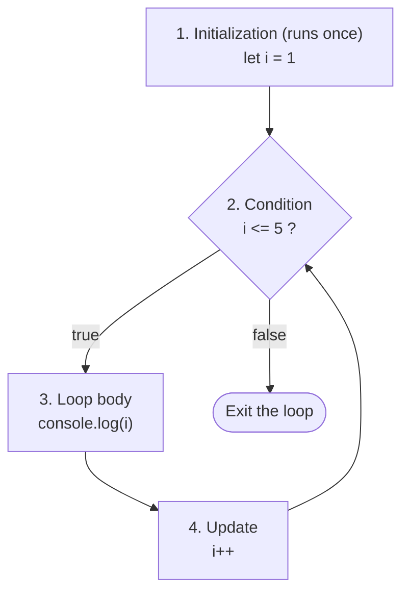

__'while' loop:__ The ```while``` loop is used when the number of iterations is not known in advance, and the loop continues as long as a specified condition is ```true```.

```javascript
// Example: Print numbers from 1 to 5 using a while loop
let i = 1;
while (i <= 5) {
  console.log(i);
  i++;
}
```

__'do-while' loop:__ Similar to the ```while``` loop, but the condition is checked after the loop block is executed, ensuring that the block is executed at least once.

```javascript
// Example: Print numbers from 1 to 5 using a do-while loop
let i = 1;
do {
  console.log(i);
  i++;
} while (i <= 5);
```

The only difference between them is *when* the condition is checked:

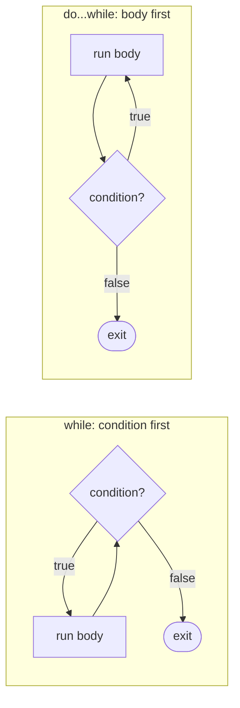

If the condition is ```false``` from the start, a ```while``` loop runs zero times, while a ```do-while``` loop still runs once.

__Looping through arrays:__ While coding, we might often use loops to iterate over the elements of an array. So, the immediate code that comes to mind for doing so is:

```javascript
// Example: Iterate through an array using a for loop
const colors = ['red', 'green', 'blue'];

for (let i = 0; i < colors.length; i++) {
  console.log(colors[i]);
}
```

Notice that the condition ```i < colors.length``` is evaluated before every iteration. You may find older tutorials recommending that you store ```colors.length``` in a variable before the loop, so it isn't read again on every iteration:

```javascript
// Example: Iterate through an array using a for loop
const colors = ['red', 'green', 'blue'];
const colorsLength = colors.length; 

for (let i = 0; i < colorsLength ; i++) { 
  console.log(colors[i]); // Same output as before
}
```

This is an example of __code refactoring__, which is nothing more than improving code that is already there. However, for regular arrays, reading ```.length``` is a very cheap property lookup, and modern JavaScript engines optimize it, so the performance gain is negligible. The idea is still valuable in a broader sense: avoid repeating *expensive* work inside a loop condition, such as calling a function that performs heavy calculations. For ordinary arrays, prefer whichever version is more readable, which is usually the first one or the ```for...of``` loop shown below.

Ps. We can also iterate through arrays using the ```array.forEach()``` method, or create new arrays from existing ones with ```array.map()```. Both will be covered later in this same tutorial.

__'for...of' loop:__ This loop in JavaScript is used to iterate over iterable objects, such as arrays, strings, and other iterable collections. It provides a more concise syntax for iterating over the values of an iterable compared to the traditional for loop. Check these examples:

```javascript
// Using for...of loop with arrays
const colors = ['red', 'green', 'blue'];

for (const color of colors) {
  console.log(color);
}

// Using for...of loop with strings
const message = 'Hello';

for (const char of message) {
  console.log(char);
}

// Using for...of loop with objects
// Plain objects are NOT iterable, so we first convert them with Object.entries()
const person = {
  name: 'John',
  age: 30,
  city: 'New York',
};

// Object entries() method to convert object properties to an iterable
for (const [key, value] of Object.entries(person)) {
  console.log(`${key}: ${value}`);
}
```

Considerations while using __for...of__:

* Syntax: The ```for``` loop is more general-purpose and has a more complex syntax, allowing for more flexibility in controlling the iteration process. The ```for...of``` loop provides a simpler syntax specifically designed for iterating over iterable elements, making the code more readable and concise.

* Iterating over Values: In a ```for``` loop, you typically use an index to access elements by their position in the array or collection. In a ```for...of``` loop, you directly iterate over the values of the iterable, making it more convenient for scenarios where you are interested in the values themselves rather than their indices.

* Performance: For simple array iteration, the performance difference between the two is negligible. In more complex scenarios or with large datasets, micro-benchmarks might show differences, but these differences are unlikely to be noticeable in typical applications.

* Use cases: If you only need the values and not the indices, a ```for...of``` loop is often more concise and easier to read. If you really need both the index and the value during iteration, you can use a traditional ```for``` loop, or combine ```for...of``` with ```array.entries()```: ```for (const [index, color] of colors.entries()) { ... }```.

__Loop control statements:__ JavaScript provides loop control statements like ```break``` and ```continue``` to alter the flow of a loop. 

```javascript
// Example 1: Use break to exit a loop early
for (let i = 1; i <= 10; i++) {
  if (i === 5) {
    break; // Exit the loop when i is 5
  }
  console.log(i); // Shows 1 to 4
}

// Example 2: Use continue to skip the current iteration
for (let i = 1; i <= 5; i++) {
  if (i === 3) {
    continue; // Skip the iteration when i is 3
  }
  console.log(i); // Shows 1 to 5 excluding 3
}
```

__IMPORTANT CONSIDERATION__: Loops are one of the most frequently used features in any programming language, and JavaScript provides these and other ways to loop through values. Having a good understanding of loops (in any language) is never a 'time wasted,' considering how often they are used. That's why I've decided to incorporate some 'best practices' and 'performance' considerations into the __loops__ topic, even though this tutorial is tailored for beginners.

---

### 9. Control flow IV - switch-case statements

In JavaScript, the ```switch``` statement allows code to be executed once the ```case``` statement is fulfilled. By using ```switch-case```, we have a concise way to handle multiple scenarios for a given expression. Here's an example:

```javascript
let day = 'Friday';

switch (day) {
  case 'Monday':
    console.log('It\'s the start of the week.');
    break;
  case 'Friday': // Once case statement is fulfilled:
    console.log('It\'s almost the weekend!'); // this is the line that will log the message
    break; // and this line will make the execution to stop
  default:
    console.log('Enjoy your day.');
}
```

Here's a brief explanation of how the switch statement works:

* The expression is evaluated once.
* The value of the expression is compared with the values of each case.
* If there is a match, the corresponding block of code is executed.
* The ```break``` statement is used to exit the switch block after a match. Without break, the control will fall through to the next case, even if it doesn't match.
* If no cases match, the default block (if present) is executed.

The "fall through" behavior is usually a bug when you forget a ```break```, but it can also be used on purpose to make several cases share the same code:

```javascript
let day = 'Sunday';

switch (day) {
  case 'Saturday':
  case 'Sunday':
    console.log('It\'s the weekend!'); // Runs for both 'Saturday' and 'Sunday'
    break;
  default:
    console.log('It\'s a weekday.');
}
```

__When to use:__ Use ```switch-case``` when you have multiple conditions to check against a single expression. It provides a cleaner alternative to a series of ```if-else``` statements. The ```switch-case``` is suitable when you need to perform strict equality (just like when using ```===```).

__When not to use:__ If your conditions involve complex expressions or ranges, using ```switch-case``` might not be the most suitable choice. In such cases, consider using ```if-else``` statements. If your cases involve non-constant expressions (that will be evaluated), it might lead to unexpected behavior. Also it is important to avoid changing the value of the expression within the ```switch``` block, as it can lead to unpredictable results.

__Performance considerations:__ When checking a small number of conditions, the performance difference between ```switch``` and ```if-else``` is typically negligible. Modern JavaScript engines are optimized to handle both constructs efficiently. In practice, the choice between ```switch``` over ```if-else``` should be based on code readability and maintainability, not aiming to improve the performance by some milliseconds. In some complex scenarios, ```if-else``` statements can be faster than ```switch-case```, but having to worry about this is not considered typical.

Note: In the examples provided, the use of ```\``` within the ```console.log``` statement ensures that the JavaScript interpreter does not become confused by the single quotes used to delimit the string text. Alternatively, you could wrap the text in double quotes (```"It's the weekend!"```) or backticks, which makes escaping unnecessary.

---

### 10. Basics of functions

In JavaScript, functions are blocks of reusable code that can be defined and called upon to perform a specific task. They play a crucial role in organizing and structuring code, promoting reusability, and enhancing maintainability. There are two common ways to define functions in JavaScript: function declarations and function expressions.

__Function Declaration:__ A function declaration is a way to define a function with the function keyword, followed by the function name, a list of parameters enclosed in parentheses, and a block of code enclosed in curly braces.

```javascript
// Defining the function
function add(x, y) {
  // Calculating the sum of x and y
  const sum = x + y;
  
  // Returning the calculated sum
  return sum;
}

// Calling the function and storing the returned value in a 'const'
const mySum = add(3, 7);

// Displaying the result
console.log(mySum) // Output: 10
```

In this example:

* __add__ is the function name
* __(x, y)__ are the parameters or 'placeholders' that represent the data that the function is receiving when called
* __const sum = x + y;__ represents the function body, where the actual code is executed
* __return sum;__ is result returned after the code is executed

In JavaScript, a function declaration must have a name. The syntax for a function declaration includes the ```function``` keyword followed by the name of the function, a list of parameters enclosed in parentheses, and a block of code enclosed in curly braces. This is not required for function expressions (they are usually nameless, or "anonymous"), as we will see next.

__Function Expression:__ A function expression is another way to define a function by assigning it to a variable. This can be done using the function keyword or the more modern arrow function syntax (=>).

```javascript
// Example 1 - Using function keyword

// Defining the function while storing it as a value (as part of an expression)
const subtract = function(x, y) {
  return x - y;
};

// Calling the function and storing the returned value in a 'const'
const mySubtract = subtract(7, 3);

// Displaying the result
console.log(mySubtract) // Output: 4
```

```javascript
// Example 2 - arrow function with the arrow syntax

// Also defining the function and storing it as a value
const subtract = (x, y) => x - y;

// Calling the arrow function (nothing changes)
const mySubtract = subtract(7, 3);

// Displaying the result
console.log(mySubtract); // Output: 4
```

In both examples, the functions themselves are written without a name, yet we can reference them by associating them to values. Consequently, we call ```subtract()``` as if it were a function, while, in reality, it is a variable storing an anonymous function expression. The functions themselves don't have a separate identifier, but they are effectively named through the variables to which they are assigned. In fact, modern JavaScript engines automatically infer the name from the variable (```subtract.name``` returns ```"subtract"```), which also helps when reading error messages. If you want, you can still give a function expression its own name, for example ```const factorial = function fact(n) { ... };```.

__Function declaration vs. function expressions:__ For routine programming tasks, functions can be declared using either approach. Named functions are particularly beneficial for self-referencing, such as in recursive functions, and they contribute to clearer stack traces during debugging, potentially easing the identification of functions causing issues. There is no meaningful performance difference between them, since modern JavaScript engines are optimized to efficiently handle both. Arrow functions are often preferred not just for their modern and concise syntax but also for their predictability, especially when developers navigate through intermediate to advanced concepts like __hoisting__ and __context__.

__Types of arrow functions:__ Arrow functions provide a concise syntax for writing functions. There are two main forms of arrow functions: the short syntax for one-liner functions, and the long syntax for functions with multiple statements or requiring a more explicit structure.

* Short Syntax (One-Liner Arrow Functions as seen previously): Here the ```return``` statement is implicit and does not require curly braces.

```javascript
// Short syntax for squaring a number
const square = (x) => x * x;
```

* Long Syntax (Block Body Arrow Functions): The long syntax is used when a function requires multiple statements or a more explicit structure. It involves using curly braces ```{}``` to define a block of code. The ```return``` statement is needed explicitly if the function is expected to return a value.

```javascript
// Long syntax for a function with conditional logic
const greet = (timeOfDay) => {
  if (timeOfDay === 'morning') {
    return 'Good morning!';
  } else {
    return 'Hello!';
  }
};
```

__Default parameters:__ Since ES6, you can give parameters a default value, which is used when the argument is missing (```undefined```) at call time:

```javascript
const welcome = (name = 'guest') => `Welcome, ${name}!`;

console.log(welcome('Alice')); // Output: Welcome, Alice!
console.log(welcome());        // Output: Welcome, guest!
```

---

### 11. String Manipulation & Formatting

1) **String Manipulation: Essential Techniques and Functions**

__Concatenation:__ Concatenation in JavaScript involves merging strings together using the `+` operator. Example:

```javascript
const firstName = "John";
const lastName = "Doe";

const fullName = firstName + " " + lastName;

console.log(fullName);  // Output: John Doe
```

__.length:__ The `.length` property retrieves the number of characters in a string. Example:

```javascript
const greeting = "Hello, JavaScript!";
const lengthOfGreeting = greeting.length;

console.log(`The length of the greeting is ${lengthOfGreeting} characters.`);  // Output: 18 characters
```

__.trim():__ The `trim()` method removes leading and trailing whitespace from a string. Example:

```javascript
const spacedString = "   Trim me!   ";
const trimmedString = spacedString.trim();

console.log(`Original String: "${spacedString}"`);
console.log(`Trimmed String: "${trimmedString}"`);
// Output: "Trim me!"
```

__String Slicing:__ In JavaScript, you can slice a string using the `slice()` method, which extracts a portion of the string by specifying a start and end index. Example:

```javascript
const sentence = "This is a sample sentence.";

// Extract substring from index 5 to 10 (excluding 10)
const substring = sentence.slice(5, 10);

console.log(`Substring: "${substring}"`);  // Output: Substring: "is a " (note the trailing space at index 9)

// Negative indexes count from the end of the string
console.log(sentence.slice(-9));  // Output: sentence.
```

__.toUpperCase() and .toLowerCase():__ These methods convert strings to uppercase or lowercase, respectively. Example:

```javascript
const mixedCase = "My TeXt MeSsage";

// Convert to uppercase
const upperCase = mixedCase.toUpperCase();

// Convert to lowercase
const lowerCase = mixedCase.toLowerCase();

console.log(`Uppercase: ${upperCase}`);  // Output: Uppercase: MY TEXT MESSAGE
console.log(`Lowercase: ${lowerCase}`);  // Output: Lowercase: my text message
```

__.replace():__ The `replace()` method searches for a specified value in a string and replaces it with another value. Example:

```javascript
const string = "Hello, World!";
const newString = string.replace("World", "Universe");

console.log(newString);  // Output: Hello, Universe!
```

Be aware that, when given a string, `.replace()` only replaces the __first__ occurrence. To replace all of them, use `.replaceAll()`:

```javascript
const path = "a-b-c";

console.log(path.replace("-", "/"));     // Output: a/b-c
console.log(path.replaceAll("-", "/"));  // Output: a/b/c
```

JavaScript offers a wide range of string methods, such as `.includes()`, `.indexOf()`, `.split()`, `.startsWith()`, `.endsWith()`, and `.padStart()`, which you can explore for further manipulation. Remember that strings are primitives, so none of these methods change the original string; they always return a new one.

2) **Strings Formatting:**

__Template Literals (Introduced in ES6):__ Template literals are a powerful and flexible way to format strings in JavaScript. They use backticks (`` ` ``) instead of single or double quotes, allowing for the direct embedding of expressions or variables inside curly braces `${}`. This provides a cleaner, more readable syntax compared to traditional concatenation.

Key advantages of template literals:

- **Multiline Strings**: You can easily create multiline strings without the need for escape characters.
- **Variable Interpolation**: Embed variables and expressions directly inside the string.
- **Expression Evaluation**: You can evaluate any valid JavaScript expression within `${}`.

__Example: Basic Variable Interpolation__

```javascript
const name = "Charlie";
const age = 35;
const formattedString = `My name is ${name} and I am ${age} years old.`;

console.log(formattedString);  
// Output: My name is Charlie and I am 35 years old.
```

__Example: Expression Evaluation__  
You can perform calculations or call functions directly within a template literal:

```javascript
const length = 7;
const width = 5;

const areaMessage = `The area of the rectangle is ${length * width} square units.`;

console.log(areaMessage);  
// Output: The area of the rectangle is 35 square units.
```

__Example: Multiline Strings__  
Template literals support multiline strings without needing `\n` for line breaks:

```javascript
const multiLineMessage = `This is a string
that spans multiple
lines easily.`;

console.log(multiLineMessage);
/*
Output:
This is a string
that spans multiple
lines easily.
*/
```

__Example: Nesting Template Literals__  
You can even nest template literals or use them within complex expressions:

```javascript
const person = { name: "Alice", age: 30 };

const greeting = `Hello, ${person.name}. ${
  person.age >= 18 ? "You are an adult." : "You are a minor."
}`;

console.log(greeting);
// Output: Hello, Alice. You are an adult.
```

Template literals make JavaScript string manipulation much cleaner and more intuitive, especially when dealing with dynamic values, expressions, or multiline strings. They are now the go-to method for formatting strings in modern JavaScript development.

---

### 12. Scope I: Types of Scope and Hoisting in JavaScript

Scope in JavaScript defines the context in which variables are accessible. The main types are:

1. **Global Scope**: Variables declared outside any function or block are globally accessible throughout the code.
   
2. **Function Scope**: Variables declared inside a function are only accessible within that function.

3. **Block Scope**: Introduced in ES6, variables declared with `let` and `const` are limited to the nearest set of curly braces `{}`.

Scopes are nested inside each other. Code can always look *outward* to find a variable in an enclosing scope, but never *inward*:

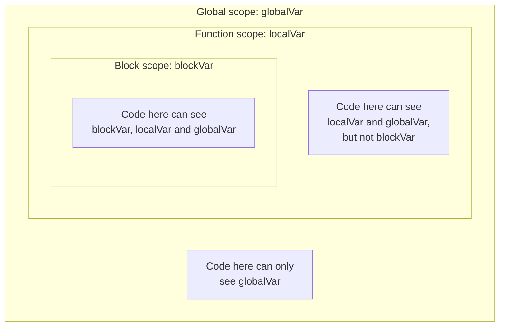

When JavaScript looks up a variable, it first checks the current scope, then the enclosing one, and so on until it reaches the global scope. If the variable isn't found anywhere, a `ReferenceError` is thrown. This chain of scopes is called the __scope chain__.

Hoisting is a behavior where JavaScript appears to move variable and function declarations to the top of their scope. In reality, nothing is moved: before running the code, the engine registers all declarations of each scope, which produces that effect. As a result, function declarations can be called before they appear in the code, and `var` variables can be accessed before their declaration (returning `undefined`), since only the declarations are hoisted, not the initializations. Variables declared with `let` and `const` are hoisted too, but they can't be accessed before their declaration (more on that in the next section).

Examples:

- Global Scope Example:

```javascript
let globalVar = "I'm global";

function exampleFunction() {
  console.log(globalVar); // Accessible
}

console.log(globalVar); // Accessible
exampleFunction();
```

- Function Scope Example:

```javascript
function localScopeExample() {
  let localVar = "I'm local";
  console.log(localVar); // Accessible
}

localScopeExample();
// console.log(localVar); // Error: localVar is not defined
```

 - Block Scope Example:

```javascript
if (true) {
  let blockVar = "I'm in a block";
  console.log(blockVar); // Accessible
}
// console.log(blockVar); // Error: blockVar is not defined
```

 - Variable Hoisting Example:

```javascript
console.log(hoistedVar); // Outputs: undefined
var hoistedVar = "I'm hoisted";
```

 - Function Hoisting Example:

```javascript
hoistedFunction(); // Works
function hoistedFunction() {
  console.log("I'm a hoisted function");
}
```

- Function Expression Hoisting (Not Hoisted):

```javascript
hoistedExpression(); // TypeError: hoistedExpression is not a function
var hoistedExpression = function() {
  console.log("I'm not hoisted");
};
```

Here, the `var hoistedExpression` declaration is hoisted (with the value `undefined`), but the function assigned to it is not. That's why the error says it "is not a function" instead of "is not defined".

In Summary: Hoisting affects declarations, not initializations or assignments. Function declarations are hoisted together with their body, but function expressions are not. Understanding scope and hoisting helps write more predictable and maintainable JavaScript.

---

### 13. Scope II: Dealing with var, let and const

In JavaScript, the keywords `var`, `let`, and `const` are used to declare variables, each with different rules for scope, hoisting, and mutability. Here’s a clearer breakdown with examples:

##### a) `var`:

**Scope**: `var` is either globally scoped (when declared outside a function) or function-scoped (when declared inside a function). It **ignores block scope**.

**Hoisting**: `var` declarations are hoisted to the top of their scope, meaning they are available before the line where they are declared, but the value is initialized to `undefined`. Example:

```javascript
console.log(x); // undefined
var x = 10;
console.log(x); // 10

if (true) {
  var y = 20;
}
console.log(y); // 20 (global scope)
```

##### b) `let`:

**Scope**: `let` is block-scoped, meaning the variable is only accessible within the block in which it’s declared (e.g., inside an `if` statement or loop).

**Hoisting**: `let` is hoisted, but not initialized. Accessing it before initialization throws a `ReferenceError`. The period between the start of the scope and the line where the variable is declared is called the __Temporal Dead Zone (TDZ)__. Example:

```javascript
// console.log(a); // ReferenceError: Cannot access 'a' before initialization
let a = 30;

if (true) {
  let b = 40;
  console.log(b); // 40 (block scope)
}
// console.log(b); // ReferenceError: b is not defined (outside the block scope)
```

##### c) `const`:

**Scope**: Like `let`, `const` is block-scoped.

**Hoisting**: `const` is hoisted, but not initialized. Accessing it before initialization also throws a `ReferenceError`.

**Immutability**: `const` must be initialized when declared and cannot be reassigned. However, if the value is an object or array, the contents can be modified. Example:

```javascript
const z = 50;
// z = 60; // TypeError: Assignment to constant variable

const arr = [1, 2, 3];
arr.push(4); // Allowed, as the array contents can be changed
console.log(arr); // [1, 2, 3, 4]

// console.log(c); // ReferenceError
const c = 70;
``` 

In summary:

- `var` is function-scoped and hoisted, but not block-scoped.
- `let` and `const` are block-scoped, hoisted but uninitialized before their declaration.
- `const` requires an initial value and can't be reassigned, though objects and arrays can be mutated.

| | `var` | `let` | `const` |
|---|---|---|---|
| Scope | Function (or global) | Block | Block |
| Access before declaration | Returns `undefined` | `ReferenceError` (TDZ) | `ReferenceError` (TDZ) |
| Can be reassigned | Yes | Yes | No |
| Can be re-declared in the same scope | Yes | No | No |
| Must be initialized when declared | No | No | Yes |

Rule of thumb: use `const` by default, switch to `let` only when the variable really needs to be reassigned, and avoid `var` in modern code.

---

### 14. Essential array methods (.map(), .find(), .filter(), .reduce())

In JavaScript, ```.map()```, ```.filter()```, ```.find()```, and ```.reduce()``` are essential array methods, offering concise and expressive ways to transform, filter, and retrieve elements. Often associated with modern coding approaches such as functional programming, they play a crucial role in enhancing code readability and maintainability, making them essential tools for effective JavaScript development.

__.map():__ The ```.map()``` method is used to transform each element of an array by applying a provided function to it. It creates a new array containing the results of applying the function to each element of the original array.

Example: Doubling each element in an array

```javascript
const numbers = [1, 2, 3, 4, 5];

const doubledNumbers = numbers.map(function (num) {
  return num * 2;
});

console.log(doubledNumbers); // Output: [2, 4, 6, 8, 10]
```

In this example, the ```.map()``` method applies the function ```(num) => num * 2``` to each element in the numbers array, resulting in a new array where each element is doubled.

__.find():__ The ```.find()``` method is used to retrieve the first element in an array that satisfies a given condition. It stops iterating once the first matching element is found.

Example: Finding the first even number in an array

```javascript
const numbers = [1, 3, 5, 8, 9];

const firstEvenNumber = numbers.find(function (num) {
  return num % 2 === 0;
});

console.log(firstEvenNumber); // Output: 8
```

Here, the ```.find()``` method searches through the numbers array and returns the first element that satisfies the condition ```(num) => num % 2 === 0```, which is the number ```8```.

__.filter():__ The ```.filter()``` method is used to create a new array containing elements that satisfy a given condition. It creates a new array with all elements for which the provided function returns true.

Example: Filtering out odd numbers from an array

```javascript
const numbers = [1, 2, 3, 4, 5];

const evenNumbers = numbers.filter(function (num) {
  return num % 2 === 0;
});

console.log(evenNumbers); // Output: [2, 4]
```

In this example, the ```.filter()``` method creates a new array (```evenNumbers```) containing only even numbers as per the condition ```(num) => num % 2 === 0```. That way we will get the following array: ```[2, 4]```.

__.reduce():__ The ```.reduce()``` method "reduces" an array to a single value (a number, a string, an object, etc.). It calls the provided function for each element, passing along an __accumulator__ that carries the result from one call to the next. The second argument of ```.reduce()``` is the accumulator's initial value.

Example: Summing all elements of an array

```javascript
const numbers = [1, 2, 3, 4, 5];

const total = numbers.reduce(function (accumulator, num) {
  return accumulator + num;
}, 0); // 0 is the initial value of the accumulator

console.log(total); // Output: 15
```

Here, the accumulator starts at ```0``` and becomes ```1```, ```3```, ```6```, ```10```, and finally ```15```.

__.forEach():__ When you just want to *do something* with each element (like logging it) and don't need a new array back, use ```.forEach()```. It always returns ```undefined```.

```javascript
const colors = ['red', 'green', 'blue'];

colors.forEach((color, index) => {
  console.log(`${index}: ${color}`); // Output: 0: red, 1: green, 2: blue
});
```

Comparing what each method gives back, using arrow functions for brevity:

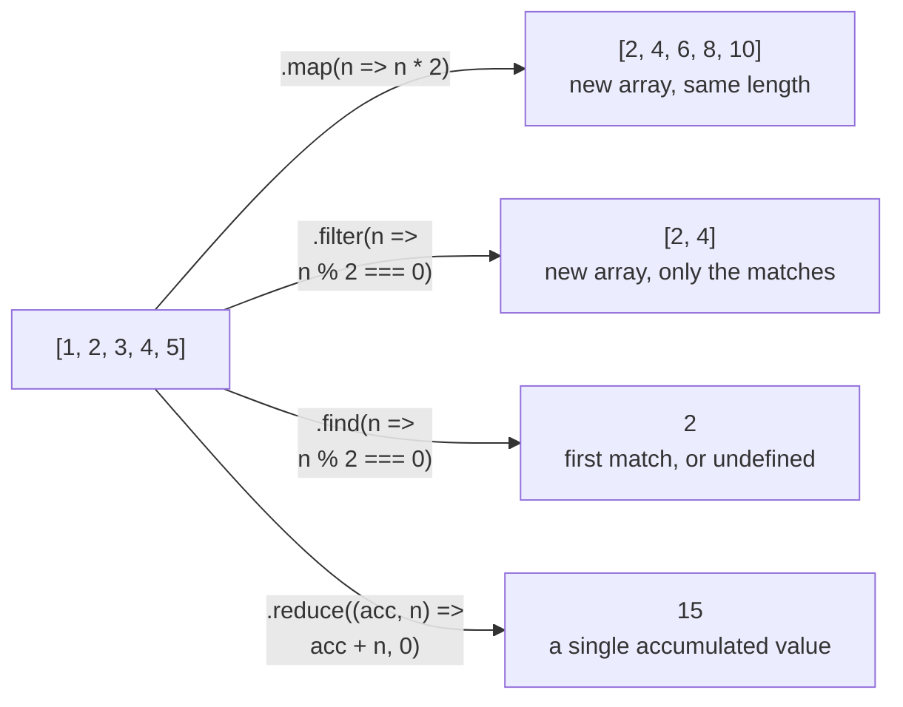

None of these methods change the original array, which makes them a great fit for the immutability concepts covered in Section 28. Because ```.map()``` and ```.filter()``` return arrays, you can also chain them: ```numbers.filter(n => n % 2 === 0).map(n => n * 10)``` returns ```[20, 40]```.

---

### 15. Built-In JavaScript mathematical features

The JavaScript Math object is a built-in feature that provides a wide range of mathematical functions and constants. It enables developers to perform common mathematical operations efficiently within their JavaScript code, offering shortcuts for tasks such as trigonometry, exponentiation, rounding, and more. This object simplifies complex numerical computations, enhancing the functionality of JavaScript applications.

__Mathematical constants:__ In JavaScript, built-in mathematical constants are predefined values that represent fundamental mathematical quantities. We can access these constants as follows:

```javascript
// Pi (π): Represents the ratio of the circumference of a circle to its diameter
const pi = Math.PI; // Approximately 3.14159

// Euler's number (e): Represents the base of the natural logarithm
const e = Math.E; // Approximately 2.71828

// Square root of 2 (√2): Represents the square root of 2
const sqrt2 = Math.SQRT2; // Approximately 1.41421

// Reciprocal of the square root of 2 (1/√2)
const sqrt1_2 = Math.SQRT1_2; // Approximately 0.70711

// Natural logarithm of 2 (ln(2))
const ln2 = Math.LN2; // Approximately 0.69315

// Natural logarithm of 10 (ln(10))
const ln10 = Math.LN10; // Approximately 2.30259
```

Note: While these constants are typically defined precisely in mathematics, their representations in JavaScript (and many other programming languages) are approximations due to the limitations of floating-point arithmetic and the finite precision of computer systems. Therefore, the values provided in JavaScript for these mathematical constants are approximate, but they are accurate enough for most practical purposes in programming and numerical computations.

__Mathematical functions:__ The Math object in JavaScript offers a suite of built-in functions tailored for common mathematical operations. Here's how we can utilize them:

```javascript
// Exponentiation (Math.pow) - the ** operator does the same: 2 ** 3
const result = Math.pow(2, 3); // result equals 8 (2 raised to the power of 3)

// Square Root (Math.sqrt)
const squareRoot = Math.sqrt(25); // squareRoot equals 5 (square root of 25)

// Absolute Value (Math.abs)
const absoluteValue = Math.abs(-10); // absoluteValue equals 10 (absolute value of -10)

// Trigonometric Functions: sine (Math.sin), cosine (Math.cos), tangent (Math.tan)
const sineValue = Math.sin(Math.PI / 2); // sineValue equals 1 (sin(π/2) is 1)
const cosineValue = Math.cos(Math.PI); // cosineValue equals -1 (cos(π) is -1)
const tangentValue = Math.tan(0); // tangentValue equals 0 (tan(0) is 0)

// Rounding: Round (Math.round), Ceil (Math.ceil), Floor (Math.floor)
const roundedNumber = Math.round(4.6); // roundedNumber equals 5 (rounds to the nearest integer)
const ceiledNumber = Math.ceil(4.3); // ceiledNumber equals 5 (rounds up to the nearest integer)
const flooredNumber = Math.floor(4.9); // flooredNumber equals 4 (rounds down to the nearest integer)

// Removing the decimal part (Math.trunc)
const truncated = Math.trunc(-4.9); // truncated equals -4 (unlike Math.floor, which gives -5)

// Largest and smallest values (Math.max, Math.min)
const highest = Math.max(3, 7, 2); // highest equals 7
const lowest = Math.min(3, 7, 2);  // lowest equals 2

// Logarithmic Functions: Natural Logarithm (Math.log), Base 10 Logarithm (Math.log10)
const naturalLog = Math.log(Math.E); // naturalLog equals 1 (ln(e) is 1)
const logBase10 = Math.log10(100); // logBase10 equals 2 (log10(100) is 2)
```

__Random numbers:__ ```Math.random()``` returns a pseudo-random decimal number between 0 (inclusive) and 1 (exclusive). Combined with ```Math.floor()```, it can generate random integers within a range:

```javascript
const randomDecimal = Math.random(); // e.g. 0.7362...

// Random integer between min and max (both inclusive)
const min = 1;
const max = 6;
const diceRoll = Math.floor(Math.random() * (max - min + 1)) + min; // 1, 2, 3, 4, 5 or 6
```

Note: ```Math.random()``` is fine for games and simulations, but it is not secure enough for things like passwords or tokens. For those cases, use ```crypto.getRandomValues()``` or ```crypto.randomUUID()```.

__Floating-point precision:__ Since numbers are stored in binary floating-point format, some decimal values can't be represented exactly. This leads to a classic surprise:

```javascript
console.log(0.1 + 0.2);                    // 0.30000000000000004
console.log(0.1 + 0.2 === 0.3);            // false
console.log((0.1 + 0.2).toFixed(2));       // "0.30" (rounded, returned as a string)
```

This is not a JavaScript bug; most programming languages behave the same way. When precision matters (for example, money), a common approach is to work with integers (cents instead of dollars) and round the results for display.

---

### 16. Objects and common object methods in JavaScript

In reinforcing a previously mentioned concept in this tutorial, it's worth noting that objects in JavaScript are comprised of key-value pairs. Each key is a string (or, less commonly, a Symbol), while each corresponding value can be any data type, encompassing primitive values such as strings, numbers, and booleans, as well as other objects or functions. For instance:

```javascript
// Creating an object with key-value pairs
const person = {
    name: "John",       // key: "name", value: "John"
    age: 30,            // key: "age", value: 30
    address: {          // key: "address", value: an object
        city: "New York",
        country: "USA"
    },
    greet: function() { // key: "greet", value: a function
        console.log("Hello!");
    }
};

// Accessing values using keys
console.log(person.name);          // Output: John
console.log(person.address.city);  // Output: New York

// Calling a function stored as a value
person.greet();  // Output: Hello!
```

__Prototypes and object creation:__ To delve deeper into understanding objects in JavaScript, it's essential to grasp the concept of prototypes and their relationship with objects. Prototypes in JavaScript act as mechanisms enabling objects to inherit properties and methods from other objects. Each object in JavaScript possesses a prototype, functioning as a "template" dictating the object's properties and methods. When accessing a property or method on an object, JavaScript initially checks if the object directly holds that property or method. If not, it traverses the prototype chain to locate the property or method on the object's prototype. Prototypes facilitate code reuse and inheritance in JavaScript, simplifying the creation and management of intricate object structures. Using a constructor function, we can create instances of objects by employing the ```new``` keyword. 

Here's a concise example demonstrating the use of prototypes and object's creation:

```javascript
// Define a function that can be used as a constructor, enabling object creation.
function Person(name) {
  this.name = name;
}

// Add a method to the Person prototype
Person.prototype.greet = function() {
  console.log(`Hello, my name is ${this.name}.`);
};

// Create an instance of Person
const person1 = new Person("John");

// Call the greet method
person1.greet(); // Output: Hello, my name is John.
```

When ```person1.greet()``` is called, JavaScript doesn't find ```greet``` on ```person1``` itself, so it follows the prototype chain until it finds it:

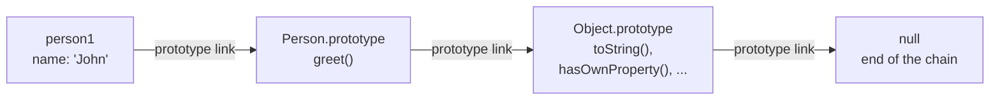

That's also why every object can call methods like ```toString()``` even though we never defined them: they live on ```Object.prototype```, at the end of the chain. You can inspect an object's prototype with ```Object.getPrototypeOf(person1)```.

__Common approaches for object creation in Javascript:__ Object Creation in JavaScript involves utilizing different methods to create objects. Here are some common approaches:

1) Object Literals: Objects can be created using object literals, which define the object's properties and values within curly braces {}.

```javascript
const person = {
    name: "John",
    age: 30,
    city: "New York"
};
```

2) Constructor Functions: Constructor functions are used to create multiple objects with similar properties and methods. 

```javascript
function Person(name, age, city) {
    this.name = name;
    this.age = age;
    this.city = city;
}

let person1 = new Person("Alice", 25, "London");
let person2 = new Person("John", 30, "New York");
```

3) Object.create() Method: The ```Object.create()``` method creates a new object with the specified prototype object and properties.

```javascript
let personPrototype = {
    greet: function() {
        console.log("Hello!");
    }
};

let person = Object.create(personPrototype);
```

4) Using classes: In ECMAScript 2015 (ES6) and later versions of JavaScript, the ```class``` keyword was introduced to provide a more familiar syntax for defining classes and constructor functions. This makes object-oriented programming in JavaScript more intuitive, especially for developers transitioning from class-based languages like Java or C++. To create an object using a class in JavaScript (ES6+), we define a class with the ```class``` keyword. 

```javascript
class Person {
  constructor(name, age) {
    this.name = name;
    this.age = age;
  }

  // Methods defined here are automatically placed on Person.prototype
  greet() {
    console.log(`Hello, my name is ${this.name}.`);
  }
}

let person1 = new Person("John", 30);
console.log(person1.name); // Output: John
person1.greet();           // Output: Hello, my name is John.
```

Under the hood, classes still use the same prototype mechanism shown earlier; they are mostly a cleaner syntax on top of it.

These methods provide flexibility in creating and initializing objects in JavaScript to suit different programming needs. So we can consider:

* Object Literals: Perfect for creating simple, static objects with predefined properties.
* Constructor Functions: Best for creating multiple instances of objects with similar properties and behaviors.
* Object.create(): Useful for explicit prototype-based inheritance, allowing properties to be inherited from existing objects.
* ES6 Classes: Offer a clearer and more organized syntax for defining object blueprints and inheritance hierarchies.

NOTE: In JavaScript, when referring to operations that are associated with objects, we typically refer to them as "methods" rather than "functions". This is because they are specifically designed to operate on objects and are accessed using dot notation. However, it's important to note that these methods are still functions in a technical sense—they are just functions that are properties of an object.

__Common object methods in Javascript:__ JavaScript provides a variety of built-in methods designed for object manipulation. Let's explore some common object methods used to handle objects effectively:

1) Object.assign(): Copies properties from one or more source objects to a target object. Note that it modifies (mutates) the target object.

```javascript
const target = { number: 10 };
const source = { foo: 1, bar: 2 };
Object.assign(target, source);
console.log(target); // Output: { number: 10, foo: 1, bar: 2 }
```

2) Object.freeze(): Freezes an object, preventing any modifications to its properties.

```javascript
const obj = { prop: 42 };
Object.freeze(obj);
obj.prop = 33; // Attempted modification (silently ignored, or a TypeError in strict mode)
console.log(obj.prop); // Output: 42 (no change)
```

3) Object.seal(): Seals an object, preventing new properties from being added and existing properties from being deleted. Unlike ```Object.freeze()```, existing properties can still be changed.

```javascript
const obj = { prop: 42 };
Object.seal(obj);
delete obj.prop; // Attempted deletion (ignored)
obj.prop = 50;   // Allowed: existing properties can still be modified
console.log(obj.prop); // Output: 50 (property still exists)
```

Note: Both ```Object.freeze()``` and ```Object.seal()``` are __shallow__: if a property holds another object, that nested object can still be modified.

4) Object.hasOwn(): Checks if an object has a specified property as its *own* property, ignoring properties inherited from the prototype chain. It is the modern (ES2022) replacement for the older ```obj.hasOwnProperty()``` method, which you'll still find in a lot of existing code.

```javascript
const obj = { foo: 1 };
console.log(Object.hasOwn(obj, 'foo'));      // Output: true
console.log(Object.hasOwn(obj, 'toString')); // Output: false (inherited from Object.prototype)

// Older equivalent:
console.log(obj.hasOwnProperty('foo'));      // Output: true
```

__Constructs and Methods for iterating over objects:__ In JavaScript, there are various methods for iterating over objects:

1) for...in Loop: This loop construct (language built-in feature) helps us to iterate over the enumerable properties of an object, with each iteration providing the property name as the variable ```key```. Keep in mind that ```for...in``` also visits enumerable properties inherited through the prototype chain, which is why the methods below (that only return the object's *own* properties) are often preferred.

```javascript
const persons = {
  person1: { name: 'John', age: 30 },
  person2: { name: 'Alice', age: 25 }
};

// Iterate over object properties
for (let key in persons) {
  console.log(key, persons[key]); // Output: person1 { name: 'John', age: 30 }, person2 { name: 'Alice', age: 25 }
}
```

2) Object.keys(): Returns an array containing the keys of an object.

```javascript
const person = { name: 'John', age: 30 };
const keys = Object.keys(person);
console.log(keys); // Output: ['name', 'age']
```

3) Object.values(): Returns an array containing the values of an object.

```javascript
const person = { name: 'John', age: 30 };
const values = Object.values(person);
console.log(values); // Output: ['John', 30]
```

4) Object.entries(): Returns an array containing arrays of key-value pairs of an object.

```javascript
const person = { name: 'John', age: 30 };
const entries = Object.entries(person);
console.log(entries); // Output: [['name', 'John'], ['age', 30]]
```

These methods provide different ways to iterate over object properties, depending on your specific requirements.

__Object destructuring:__ Object destructuring in JavaScript allows for the extraction of multiple properties from an object and assigns them to variables in a single statement. Example:

```javascript
const person = {
  name: 'John',
  age: 30,
  city: 'New York'
};

// Destructuring assignment
const { name, age, city } = person;

console.log(name); // Output: John
console.log(age); // Output: 30
console.log(city); // Output: New York
```

In this example, object destructuring simplifies the process of extracting properties ```name```, ```age```, and ```city``` from the person object and assigning them to variables of the same name.

__Object merging:__ Object merging in JavaScript can be achieved using the spread syntax (...). This syntax allows you to combine the properties of multiple objects into a single object. Example:

```javascript
const obj1 = { a: 1, b: 2 };
const obj2 = { c: 3, d: 4 };

// Merge objects using spread syntax
const mergedObj = { ...obj1, ...obj2 };

console.log(mergedObj); // Output: { a: 1, b: 2, c: 3, d: 4 }
```

In this example, mergedObj contains the combined properties of obj1 and obj2. The spread syntax makes it concise and straightforward to merge objects in JavaScript. If both objects have the same key, the value from the object spread *last* wins:

```javascript
const defaults = { theme: 'light', fontSize: 14 };
const userSettings = { theme: 'dark' };

const settings = { ...defaults, ...userSettings };
console.log(settings); // Output: { theme: 'dark', fontSize: 14 }
```

__Shallow vs. deep copies:__ Both the spread syntax and ```Object.assign()``` create __shallow__ copies: nested objects are not copied, only their references are. To create a fully independent (deep) copy, use the built-in ```structuredClone()``` function:

```javascript
const original = { name: 'John', address: { city: 'New York' } };

const shallowCopy = { ...original };
const deepCopy = structuredClone(original);

original.address.city = 'Boston';

console.log(shallowCopy.address.city); // Output: Boston (shares the same nested object)
console.log(deepCopy.address.city);    // Output: New York (fully independent copy)
```

__Javascript Object Notation (JSON) and associated methods:__ JavaScript Object Notation (JSON) is a lightweight and popular data interchange format based on JavaScript object syntax. It's commonly used for transmitting data between a server and client-side applications. Methods associated with the JSON format typically revolve around the concepts of serializing (converting JavaScript objects to JSON strings) and parsing (converting JSON strings back to JavaScript objects) objects that store data. So we have:

1) JSON.stringify(): Converts a JavaScript object into a JSON string.

```javascript
const person = { name: 'John', age: 30 };
const serializedPerson = JSON.stringify(person);
console.log(serializedPerson); // Output the string representation of an object: '{"name":"John","age":30}'
```

2) JSON.parse(): Parses a JSON string and converts it into a JavaScript object.

```javascript
const jsonData = '{"name":"John","age":30}';
const person = JSON.parse(jsonData);
console.log(person.name); // Output: John
console.log(person.age); // Output: 30
```

3) JSON.stringify() with Replacer Function: Allows custom serialization by providing a 'replacer' function.

```javascript
const person = { name: 'John', age: 30, city: 'New York' };

// Convert the object to JSON string, excluding the 'city' property
const jsonData = JSON.stringify(person, (key, value) => (key === 'city' ? undefined : value));

console.log(jsonData); // Output: '{"name":"John","age":30}'
```

4) JSON.parse() with Reviver Function: Allows custom parsing by providing a 'reviver' function.

```javascript
const jsonData = '{"name":"John","age":30}';

// Parse the JSON string doubling the value of 'age' property
const person = JSON.parse(jsonData, (key, value) => (key === 'age' ? value * 2 : value));
console.log(person.age); // Output: 60
```

Note: The replacer function in ```JSON.stringify()``` enables selective serialization, allowing for exclusion or transformation of data. For example, it can be used to convert Date objects to strings. Likewise, the reviver function in ```JSON.parse()``` offers customization during parsing. For example, it can transform string representations of data back into their original formats. These functions provide flexibility in handling JSON data, accommodating various use cases such as data sanitization, transformation, and format compatibility.

---

### 17. A better understanding of null and undefined

In JavaScript, ```null``` and ```undefined``` are both used to represent absence of value, but they have different meanings and use cases. ```null``` is explicitly assigned by developers to indicate that a variable intentionally holds no value. It signifies the absence of any object value. ```undefined```, on the other hand, typically indicates an unintentional absence of value. It is the default value assigned to a variable that has been declared but not yet initialized or assigned a value. Let's say we have a variable ```userName``` that holds the name of a user. If the user hasn't provided their name yet, we might set ```userName``` to ```null``` to indicate the absence of a name intentionally. However, if ```userName``` is ```undefined```, it might indicate a programming error or oversight, such as forgetting to assign a value to userName.

Dealing with ```null``` or ```undefined``` properties within objects in JavaScript requires careful handling to prevent errors. The ```?.``` and ```??``` operators (both introduced in ES2020) provide elegant solutions for this purpose:

 * The ```?.``` operator is known as the __optional chaining operator__ and it enables safe access to nested properties within an object. It short-circuits the evaluation if a property along the path is ```null``` or ```undefined```, returning ```undefined``` instead of throwing an error.

```javascript
const user = { address: { city: 'New York' } };

// Access the city property within the address object
// If address is null or undefined, no error is thrown
console.log(user.address?.city); // Output: 'New York'

const guest = {};
console.log(guest.address?.city); // Output: undefined (no error)
// console.log(guest.address.city); // TypeError: Cannot read properties of undefined

// It also works with methods and array indexes
console.log(guest.getName?.()); // Output: undefined (method doesn't exist, no error)
console.log(guest.tags?.[0]);   // Output: undefined
```

 * The ```??``` operator is known as the __nullish coalescing operator__ and it offers a concise way to provide default values for ```null``` or ```undefined``` properties. It returns the right-hand operand if the left-hand operand is ```null``` or ```undefined```, otherwise it returns the left-hand operand.

```javascript
const user = { name: 'John', age: 30, city: null };

// Using ?? for default values
console.log(user.name ?? 'Anonymous'); // Output: 'John'
console.log(user.city ?? 'Unknown'); // Output: 'Unknown' (city is null)
```

Let's illustrate these concepts better with more examples:

```javascript
// Example object with nested properties
const user = {
  id: 1,
  name: "John",
  address: {
    street: "123 Main St",
    city: "New York",
    // comment the line below to see how the code behaves without the null property
    postalCode: null
  }
};

// Using optional chaining and nullish coalescing operators
const postalCode = user.address?.postalCode ?? "N/A";
console.log("Postal code:", postalCode);

// Combining optional chaining with default values using ?? for nested properties
const city = user.address?.city ?? "Unknown City";
console.log("City:", city);
```

It's also important to note a famous quirk of the ```typeof``` operator. Both ```null``` and ```undefined``` are primitive values, but ```typeof null``` returns ```"object"```. This is a bug from the very first version of JavaScript that was never fixed, to avoid breaking existing websites. So we will have:

```javascript
console.log(typeof null); // Output: "object" (historical bug: null is NOT an object)
console.log(typeof undefined); // Output: "undefined"
```

To check for ```null```, compare it directly: ```value === null```.

Another important consideration is when defining default values for variables. The ```??``` (nullish coalescing operator) only considers ```null``` or ```undefined``` values, whereas ```||``` (logical OR operator) considers any falsy value. For instance:

```javascript
const itemsInCart = 0;

const result1 = itemsInCart ?? 10; // 0  -> keeps 0, because 0 is not null or undefined
const result2 = itemsInCart || 10; // 10 -> replaces 0, because 0 is falsy (probably a bug!)
```

| Value | `value \|\| "default"` | `value ?? "default"` |
|---|---|---|
| `null` | `"default"` | `"default"` |
| `undefined` | `"default"` | `"default"` |
| `0` | `"default"` | `0` |
| `""` (empty string) | `"default"` | `""` |
| `false` | `"default"` | `false` |
| `"Alice"` | `"Alice"` | `"Alice"` |

Note: The boolean opposite of both ```null``` and ```undefined``` is ```true```. This means that if you use the ```!``` operator on ```null``` or ```undefined```, it will result in ```true```. However, using the ```!``` operator to check specifically for ```null``` or ```undefined``` is not recommended, because ```!``` also returns ```true``` for every other falsy value, such as ```0```, ```""```, and ```false```. A postal code stored as an empty string, for example, would be wrongly reported as missing. Here's an example of what NOT to do:

```javascript
// Using the ! operator (NOT recommended for checking null or undefined)
const isPostalCodeNull = !user.address?.postalCode; // Also true for "", 0, false...
console.log("Is postal code null or undefined?", isPostalCodeNull);
```

In that case, the recommended version of the same code would be:

```javascript
// Recommended approach for checking null or undefined
const postalCode = user.address?.postalCode;
const isPostalCodeNull = postalCode === null || postalCode === undefined;
console.log("Is postal code null or undefined?", isPostalCodeNull);
```

Ps. You may also see the shorter ```postalCode == null``` in other codebases. It's the one common exception to the "always use ```===```" rule, because ```== null``` is ```true``` for both ```null``` and ```undefined``` (and nothing else).

---

### 18. JavaScript Naming Conventions

Naming conventions in JavaScript are critical for writing clean, readable, and maintainable code. Following consistent conventions helps in understanding the purpose and scope of variables, functions, classes, and other identifiers. Here are the key conventions:

__Variable Names__: Variable names should be written in __camelCase__. This means the first word is in lowercase and the first letter of each subsequent word is capitalized.

```javascript
let userName = 'Alice';
let totalPrice = 19.99;
```

__Boolean Names__: Booleans usually start with prefixes like ```is```, ```has```, ```can``` or ```should```, so they read like a yes/no question.

```javascript
let isLoggedIn = true;
let hasPermission = false;
```

__Constant Names__: Fixed values that are known before the program runs and never change (such as configuration values, or numbers that would otherwise be unexplained "magic numbers") are commonly written in uppercase letters with words separated by underscores. Regular ```const``` variables that hold computed values still use camelCase.

```javascript
const MAX_USERS = 100;
const API_BASE_URL = 'https://api.example.com';

const currentUser = getUser(); // A regular const: camelCase
```

Note: Never hardcode secrets (like passwords or API keys) directly in your source code, especially in code that runs in the browser or is pushed to a public repository.

__Function Names__: Function names should also follow __camelCase__ convention.

```javascript
function calculateTotal(price, tax) {
  return price + tax;
}
```

__Class Names__: Class names should be written in __PascalCase__, where each word starts with an uppercase letter.

```javascript
class UserAccount {
  constructor(username, password) {
    this.username = username;
    this.password = password;
  }
}
```

__File Names__: File names should be descriptive and can use kebab-case (all lowercase with hyphens).

```text
user-controller.js
order-service.js
```

__HTML Element IDs and Classes__: IDs and class names in HTML should use kebab-case as well.

```html
<div id="main-container" class="user-profile"></div>
```

__Private Variables and Methods__: Traditionally, an underscore prefix has been used to indicate that a variable or method is intended for internal use only. This is just a convention: the property can still be accessed from outside.

```javascript
class Example {
  constructor() {
    this._internalVariable = 'not really private';
  }

  _internalMethod() {
    console.log('Accessible from outside, but you are asked not to use it');
  }
}
```

Since ES2022, classes support __truly private__ fields and methods using the ```#``` prefix. They can't be accessed from outside the class at all:

```javascript
class BankAccount {
  #balance = 0; // Private field

  deposit(amount) {
    this.#balance += amount;
  }

  getBalance() {
    return this.#balance;
  }
}

const account = new BankAccount();
account.deposit(50);
console.log(account.getBalance()); // Output: 50
// console.log(account.#balance);  // SyntaxError: Private field '#balance' must be declared in an enclosing class
```

These conventions help in understanding the purpose and scope of different identifiers at a glance, making the codebase easier to navigate and maintain. However, there is much more to JavaScript naming conventions than the essentials outlined here. In many situations, naming conventions are defined by team agreements. In other situations, linting (code revision) libraries might suggest or even enforce certain naming conventions. This ensures consistency and adherence to best practices across the entire codebase.

---

### 19. The NaN Type

 ```NaN``` is a special value in JavaScript that stands for "Not a Number." It indicates that a value is not a legal number. Despite its name, ```NaN``` is considered a type of number. Here are a few concise examples where ```NaN``` is computed in JavaScript:

* Invalid Mathematical Operations:

```javascript
let result = Math.sqrt(-1); // NaN
```

* Operations Involving Non-numeric Values:

```javascript
let result = "hello" / 2; // NaN
```

* Indeterminate Forms:

```javascript
let result = 0 / 0; // NaN
```

* Parsing Failures:

```javascript
let result = parseFloat("text"); // NaN
```

* Using Number Constructor with Non-numeric Strings:

```javascript
let result = Number("text"); // NaN
```

These scenarios highlight common cases where ```NaN``` is produced in JavaScript.

In JavaScript, ```NaN``` itself is considered a value of the number type:

```javascript
console.log(typeof NaN); // "number"
```

```NaN``` is not equal to NaN: One of the most confusing aspects of ```NaN``` is that it is not equal to itself. This behavior is unique and seems a bit counterintuitive:

```javascript
console.log(NaN === NaN); // false
```

The reason why ```NaN``` is not equal to itself (when using ```===``` or ```==```) is that JavaScript follows the IEEE 754 floating-point standard, used by most programming languages, which defines ```NaN``` as unequal to every value, including itself. It's like saying, "I don't know what this is." So, when JavaScript sees two "I don't knows" (NaN), it can't claim they are the same, since ```0 / 0``` and ```Math.sqrt(-1)``` are very different failed results. A side effect is that ```NaN``` can't be detected with a regular comparison, so we need special functions for that.

__Verifying ```NaN``` Values in JavaScript:__

The global ```isNaN()``` function converts the argument to a number before checking if it is NaN.

```javascript
console.log(isNaN(NaN)); // true
console.log(isNaN("text")); // true (string "text" is converted to NaN)
```

The ```Number.isNaN()``` checks if the value is ```NaN``` without converting the argument.

```javascript
console.log(Number.isNaN(NaN)); // true
console.log(Number.isNaN("text")); // false (string "text" is not NaN)
```

Side-by-side comparison:

```javascript
// isNaN: Converts to number, less precise.
// Number.isNaN: No conversion, more precise.
console.log(isNaN(10)); // false
console.log(isNaN(NaN)); // true
console.log(isNaN("text")); // true

console.log(Number.isNaN(10)); // false
console.log(Number.isNaN(NaN)); // true
console.log(Number.isNaN("text")); // false
```

Tip: Whenever there's a possibility of JavaScript producing a ```NaN``` value, use ```Number.isNaN()``` for a more precise check of the ```NaN``` type. Another option is ```Object.is(value, NaN)```, which also returns ```true``` only for ```NaN```.

---

### 20. Scope III: Closures, IIFEs and Best Practices

**Closures** and **IIFEs** (Immediately Invoked Function Expressions) are key concepts in JavaScript that help manage scope, especially to avoid polluting the global scope.

A closure is a function that remembers the variables from its outer (enclosing) scope, even after that outer function has finished executing. This allows the inner function to access those variables, creating a "closed" environment where the variables are preserved. Closures are commonly used to create private variables or to maintain state over time without exposing them globally. Example of a Closure:

```javascript
function outerFunction() {
  let counter = 0; // Local variable (not in global scope)

  return function innerFunction() {
    counter++; // Inner function has access to 'counter'
    console.log(counter);
  };
}

const increment = outerFunction();
increment(); // Outputs: 1
increment(); // Outputs: 2
```

In this example, `counter` is not accessible from the global scope, but the inner function can still access and modify it, thanks to its closure behavior. You can picture the returned function as carrying a "backpack" with the variables of the scope where it was created:

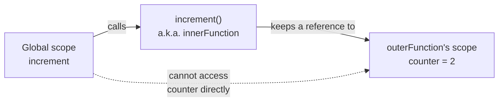

Even though `outerFunction()` has already finished running, its `counter` variable stays alive because `increment` still references it. Each call to `outerFunction()` creates a new, independent `counter`.

**IIFEs (Immediately Invoked Function Expressions):** An IIFE is a function that is defined and immediately executed. It creates a local scope to store variables without affecting the global scope, preventing variable leaks into the global environment. IIFEs are especially useful for isolating logic or data, ensuring that variables inside the function don't interfere with other parts of the code. Example:

```javascript
(function() {
  let privateVar = "I'm private";
  console.log(privateVar); // Outputs: "I'm private"
})();

// console.log(privateVar); // Error: privateVar is not defined
```

Here, `privateVar` is confined to the IIFE's local scope, keeping it out of the global scope and preventing unintended conflicts with other parts of the code.

__Why to use Closures and IIFEs?:__

- **Closures** help manage and preserve data privately while allowing functions to access it when needed.
- **IIFEs** are an effective way to structure your code and avoid polluting the global namespace with variables, which can lead to hard-to-trace bugs.

By using closures and IIFEs, you can better manage variable scope and avoid global scope pollution, leading to cleaner, more maintainable code.

__Best practices related to scope:__

* Avoid Global Variables: Limit the use of global variables to avoid polluting the global scope. Encapsulate your code within functions or modules to reduce the risk of naming conflicts and improve code maintainability.

* Use Block Scope with `let` and `const`: Avoid using `var` because it can lead to potential bugs in JavaScript code. Instead, leverage block scope with `let` and `const` to confine variables to the smallest possible scope, thereby improving code readability and reducing potential bugs.

* Avoid Creating Implicit Global Variables: Always declare variables using keywords such as `let` and `const` within the appropriate scope. Omitting the declaration keyword can unintentionally create global variables, leading to unexpected behavior and bugs.

* Enable Strict Mode: Use strict mode (which will be explained in more detail later) to enforce stricter rules in your code. It helps catch common errors, such as variable scoping issues or the use of undeclared variables, making your code more reliable and easier to debug.

* Use Immediately Invoked Function Expressions (IIFE): In main scripts, especially in traditional JavaScript applications or scripts included directly in HTML files, IIFE is often used to prevent variable and function name clashes with other scripts and libraries. It helps create a private scope where variables and functions defined inside the IIFE are not accessible outside, reducing the risk of conflicts and improving code organization.

* Prefer modules in modern code: ES modules (see Section 26) give every file its own scope automatically, so variables declared in a module never leak into the global scope. Together with block scope (`let`/`const` inside `{ }`), this makes IIFEs much less necessary today, although you'll still find them in older codebases and libraries.

---

### 21. Scope IV: Context and `this` in JavaScript + Differences Between Regular and Arrow Functions

In JavaScript, **context** refers to the value of `this`, which represents the object that is tied to a function. How `this` behaves depends on whether you're using a **regular function** or an **arrow function**.

**`this` in Regular Functions:**

In regular functions, `this` depends on *how the function is called*. In other words, it changes based on the object that is calling the function. For example:

```javascript
const obj = {
  name: "Alice",
  greet() {
    console.log(this.name); // 'this' refers to obj
  }
};

obj.greet(); // Outputs: "Alice"
```

Here, `this` points to `obj` because `obj` is the one calling the `greet` function.

If you take the function out of the object and call it on its own, `this` will no longer refer to `obj`. Instead, it might point to something else, like the global object, or it could even be `undefined` in strict mode:

```javascript
const greet = obj.greet; // Take the function out of obj
greet(); // Call the function independently
```

- **In non-strict mode**: `this` will refer to the global object (like `window` in browsers, available everywhere as `globalThis`).
- **In strict mode**: `this` will be `undefined`.

So, in regular functions, `this` is *dynamic*—it depends on how and where the function is called.

**`this` in Arrow Functions:**

Arrow functions work differently. They don’t have their own `this`. Instead, they "borrow" `this` from the surrounding code where the function is written (its **lexical scope**). 

For example:

```javascript
const obj = {
  name: "Alice",
  greet() {
    const innerFunc = () => console.log(this.name); // 'this' is inherited
    innerFunc();
  }
};

obj.greet(); // Outputs: "Alice"
```

In this case, the arrow function `innerFunc` doesn’t create its own `this`. It just uses the `this` of the `greet` method, which means `this` still points to `obj`.

**Key Differences:**

1. **Who Defines `this`:**
   - Regular functions: `this` depends on *who calls the function*. It’s set dynamically at the time of the call.
   - Arrow functions: `this` depends on *where the function is defined*. It doesn’t change, no matter how or where the function is called.

2. **Constructors:**
   - Regular functions can be used to create objects with `new`.
   - Arrow functions cannot be used as constructors.

3. **Arguments:**
   - Regular functions have their own `arguments` object (which holds all arguments passed to the function).
   - Arrow functions don’t have their own `arguments` object; they use the one from the surrounding function. In modern code, rest parameters work in both types of function and are preferred: `const sumAll = (...numbers) => numbers.reduce((acc, n) => acc + n, 0);`

**Example: Regular vs. Arrow Functions**

```javascript
const obj = {
  method: function() { console.log(this); }, // 'this' refers to obj
  arrowMethod: () => { console.log(this); } // 'this' refers to outer context
};

obj.method();      // Outputs: obj
obj.arrowMethod(); // Outputs: outer context (not obj)
```

**So we have:**

- Regular functions tie `this` to *who is calling the function*. If you call the function on an object, `this` will refer to that object. But if you call it on its own, `this` can change.
- Arrow functions tie `this` to *where the function is defined*. They inherit `this` from their surrounding code and never change it, no matter how they’re called.
- Use regular functions when working with object methods that need to use `this`.
- Use arrow functions for callbacks or functions where you want `this` to stay consistent with the surrounding code.

**How to figure out what `this` is:** When reading code, you can ask these questions in order:

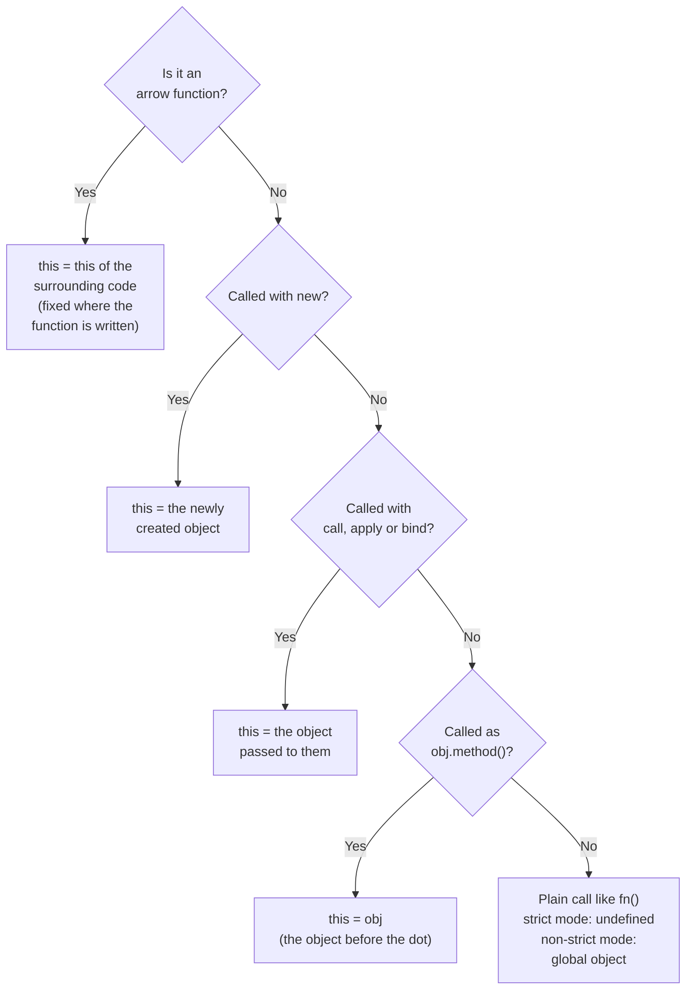

**Setting `this` explicitly with `call` and `bind`, and the "lost `this`" problem:** A very common bug happens when a method is passed around as a callback (for example, to `setTimeout` or an event listener), because it is no longer called as `obj.method()`:

```javascript
const user = {
  name: "Alice",
  greet() {
    console.log(`Hi, I'm ${this.name}`);
  }
};

user.greet();                    // "Hi, I'm Alice"
user.greet.call({ name: "Bob" }); // "Hi, I'm Bob" (call() sets `this` for a single call)

setTimeout(user.greet, 100);     // `this` is lost: it's no longer user

// Fix 1: bind() returns a new function with `this` permanently set
setTimeout(user.greet.bind(user), 100); // "Hi, I'm Alice"

// Fix 2: wrap the call in an arrow function, so it's called as user.greet() again
setTimeout(() => user.greet(), 100);    // "Hi, I'm Alice"
```

`apply()` works just like `call()`, except it receives the function's arguments as an array.

---

### 22. Error Handling in JavaScript

Error handling is a crucial aspect of writing robust JavaScript code. It involves anticipating and managing errors that can occur during the execution of a program. By properly handling errors, we can prevent our application from crashing and provide users with informative feedback.

#### Techniques for Handling Errors

1. **Try-Catch Statements**

   The `try-catch` statement is the primary way to handle exceptions (errors) in JavaScript. It allows you to write code that might throw an error inside the `try` block, and if an error occurs, the control is passed to the `catch` block, where you can handle the error.

   ```javascript
   try {
       // Code that may throw an error
       const result = riskyFunction();
       console.log(result);
   } catch (error) {
       // Handle the error
       console.error("An error occurred:", error.message);
   }
   ```

   In this example, if `riskyFunction()` throws an error, the error will be caught in the `catch` block, allowing you to log or display an error message without crashing the entire program.

2. **Finally Block**

   You can also use a `finally` block along with `try-catch`. The code inside the `finally` block will execute regardless of whether an error was thrown or not. This is useful for cleaning up resources, such as closing files or clearing timers.

   ```javascript
   try {
       // Code that may throw an error
       const data = fetchData();
       console.log(data);
   } catch (error) {
       console.error("An error occurred:", error.message);
   } finally {
       // This block will run no matter what
       console.log("Cleanup operations.");
   }
   ```

   The flow of a `try...catch...finally` statement looks like this:

   ```mermaid
   ---
   config:
     flowchart:
       wrappingWidth: 1000
     elk:
       nodePlacementAlignment: RIGHTDOWN
   ---
   flowchart TD
       A["try block runs"] --> B{"Was an error<br/>thrown?"}
       B -- No --> D["finally block runs<br/>(always)"]
       B -- Yes --> C["try stops immediately<br/>catch block runs<br/>with the error"]
       C --> D
       D --> E["Code after the<br/>statement continues"]
   ```

   Note: If the `catch` block itself throws (or re-throws) an error, the `finally` block still runs before the error continues to propagate.

3. **Throwing Errors**

   You can create your own error conditions in the code by using the `throw` statement. This allows you to generate custom error messages based on specific conditions.

   ```javascript
   function divide(a, b) {
       if (b === 0) {
           throw new Error("Cannot divide by zero.");
       }
       return a / b;
   }

   try {
       console.log(divide(10, 0));
   } catch (error) {
       console.error("Error:", error.message);
   }
   ```

   Always throw `Error` objects (or one of their subtypes) rather than plain strings, because `Error` objects carry useful information such as the `message` and the `stack` trace.

4. **Custom Error Types**

   For larger programs, you can create your own error types by extending the built-in `Error` class. This lets you handle different kinds of errors differently:

   ```javascript
   class ValidationError extends Error {
       constructor(message) {
           super(message);
           this.name = "ValidationError";
       }
   }

   function setAge(age) {
       if (age < 0) {
           throw new ValidationError("Age cannot be negative.");
       }
       return age;
   }

   try {
       setAge(-5);
   } catch (error) {
       if (error instanceof ValidationError) {
           console.error("Invalid input:", error.message); // Output: Invalid input: Age cannot be negative.
       } else {
           throw error; // Re-throw errors we don't know how to handle
       }
   }
   ```

#### Understanding Common Error Types

JavaScript has several built-in error types that you may encounter:

1. **SyntaxError**: Occurs when there is a syntax mistake in the code, such as missing parentheses or braces.
   - Example: `const a = ; // SyntaxError: Unexpected token`

2. **ReferenceError**: Happens when a non-existent variable is referenced.
   - Example: `console.log(nonExistentVariable); // ReferenceError: nonExistentVariable is not defined`

3. **TypeError**: Indicates an operation was performed on a value of the wrong type, such as trying to access a property of `undefined`.
   - Example: `const obj = null; console.log(obj.property); // TypeError: Cannot read properties of null (reading 'property')`

4. **RangeError**: Triggered when a numeric variable or parameter is outside an allowable range.
   - Example: `const arr = new Array(-1); // RangeError: Invalid array length`

By implementing proper error handling techniques, we surely will enhance the quality, reliability and user experience of our JavaScript applications.

---

### 23. Strict mode

Strict mode helps catch common coding errors and prevents the use of undeclared variables, which can lead to bugs that are harder to identify and fix.

__Enabling Strict Mode:__ To enable strict mode, you can add the following statement at the beginning of your JavaScript file or script:

```javascript
"use strict";
```

Or, if you are using it within a function, you can use:

```javascript
function myFunction() {
  "use strict";
  // Function code
}
```

Good to know: code inside ES modules (Section 26) and inside ```class``` bodies is __always__ in strict mode automatically, so you don't need to write ```"use strict"``` there.

__Undeclared Variable Error:__ When using strict mode in JavaScript, attempting to assign a value to a variable that has not been declared will result in a ReferenceError. This type of error indicates that the code is trying to reference a variable that does not exist in the current scope.

```javascript
"use strict";
x = 3.14; // Error: x is not defined
```

__Preventing Unsafe Actions:__ It disallows some actions or usage of certain features that are considered unsafe, such as:

- **Assigning values to read-only properties:** Strict mode prevents changes to properties that are not writable.
- **Using the `with` statement:** The `with` statement is not allowed in strict mode due to its potential to introduce ambiguity and confusion.

```javascript
"use strict";
var obj = {};
Object.defineProperty(obj, "prop", { value: 42, writable: false });
obj.prop = 77; // Error: Cannot assign to read-only property 'prop'
```

__Enforcing Better Coding Practices:__ Strict mode enforces stricter parsing and error handling, encouraging better coding practices and making the code more robust. For instance, it requires that all parameter names of a function be unique, preventing accidental overwrites:

```javascript
"use strict";
function myFunction(a, a, b) {
  // Error: Duplicate parameter name not allowed in this context
}
```

__Eliminating Silent Errors:__ In non-strict mode, some mistakes might fail silently or not produce errors. Strict mode makes these errors explicit and helps in identifying and fixing them during development. For example, changing a frozen object (see Section 16) is silently ignored in non-strict mode, so the bug can go unnoticed:

```javascript
// Non-strict mode: the assignment silently does nothing
const config = Object.freeze({ debug: false });
config.debug = true;
console.log(config.debug); // false (no error, but our change was lost!)
```

```javascript
"use strict";
// Strict mode: the same mistake throws an error we can see and fix
const config = Object.freeze({ debug: false });
config.debug = true; // TypeError: Cannot assign to read only property 'debug' of object
```

**Key Features of Strict Mode**: Here’s a list of key features of JavaScript strict mode:

1. **Prevents undeclared variables**: Throws an error if a variable is used without being declared.
2. **Disallows duplicate function parameters**: Using the same parameter name twice in a function is not allowed.
3. **Prohibits the `with` statement**: The `with` statement is disallowed as it makes code harder to optimize and debug.
4. **Changes `this` in functions**: If `this` is not set explicitly in a function, it becomes `undefined` instead of defaulting to the global object.
5. **No silent assignment to read-only properties**: Assigning to non-writable properties throws an error.
6. **No deleting variables or functions**: Attempting to delete a variable or a function is prohibited and throws an error.
7. **Prohibits `eval` from creating variables in the surrounding scope**: Variables and functions declared inside `eval` are confined to the `eval` scope.
8. **No legacy octal literals**: Old-style octal literals (numbers starting with `0`, like `010`) are not allowed. The modern `0o` prefix (like `0o10`) is still fine.

__Transitioning to Strict Mode__: Always keep in mind that enabling strict mode might cause existing code to behave differently, as it disallows certain actions that were previously allowed. Therefore, it's recommended to test thoroughly when transitioning existing code to strict mode. Additionally, always check for the latest JavaScript language specifications and best practices, as recommendations may evolve over time. By adhering to strict mode, you can write more reliable, maintainable, and secure JavaScript code, making it easier to debug and maintain in the long run.

---

### 24. Associating JavaScript Code with an HTML Page

To run JavaScript on a webpage, you typically associate it with your HTML document using the `<script>` tag. This can be done either by embedding the JavaScript code directly in the HTML file or by linking to an external JavaScript file.

1. **Internal Script (Inline JavaScript)**:
   You can write JavaScript code directly inside your HTML file within a `<script>` tag:
   
   ```html
   <!DOCTYPE html>
   <html>
   <head>
       <title>My Page</title>
   </head>
   <body>
       <h1>Hello World</h1>
       <script>
           console.log("This is inline JavaScript running.");
       </script>
   </body>
   </html>
   ```

2. **External Script**:
   JavaScript code is often stored in external files (with a `.js` extension), which are then linked to the HTML using the `<script>` tag.

   ```html
   <!DOCTYPE html>
   <html>
   <head>
       <title>My Page</title>
   </head>
   <body>
       <h1>Hello World</h1>
       <script src="main.js"></script> <!-- Linking to an external JS file -->
   </body>
   </html>
   ```

__Loading JavaScript Efficiently__: JavaScript can block the rendering of the HTML page if it's loaded at the wrong time. To avoid this, you can control when and how your JavaScript is loaded.

1. **Default Loading Behavior (Blocking)**:
   By default, `<script>` tags placed in the `<head>` or before the closing `</body>` tag load and execute immediately. If placed in the `<head>`, JavaScript blocks the browser from rendering the page until the script has fully loaded and executed.

   ```html
   <script src="main.js"></script> <!-- This line blocks page rendering until the file is fully loaded -->
   ```

2. **Using `defer` Attribute (Non-blocking)**:
   The `defer` attribute tells the browser to download the script while it continues parsing the HTML, but it only executes the script after the HTML document has fully loaded. This ensures that the script doesn’t block page rendering.

   ```html
   <script src="main.js" defer></script> <!-- Non-blocking, runs after HTML is fully parsed -->
   ```

   Scripts with `defer` maintain their order of execution if there are multiple `defer`-ed scripts.

3. **Using `async` Attribute**:
   The `async` attribute downloads and executes the script as soon as it’s ready, without waiting for the rest of the HTML to be parsed. However, `async` does not guarantee the order of execution if you have multiple scripts.

   ```html
   <script src="analytics.js" async></script> <!-- Loads and runs immediately when ready -->
   ```

   Use `async` for independent scripts that don’t depend on the rest of the page or other scripts (e.g., analytics or third-party libraries).

4. **Using `type="module"`**:
   Scripts that use ES modules (`import`/`export`, see Section 26) must be loaded with `type="module"`. Module scripts are deferred automatically, so they behave like `defer` without needing the attribute.

   ```html
   <script type="module" src="main.js"></script> <!-- Deferred by default -->
   ```

Order of Loading and Execution:

- **Without `async` or `defer`**: JavaScript blocks the HTML parsing and loads in the order it appears.
- **With `defer`**: JavaScript is executed after the HTML is fully parsed, but still maintains the order of appearance.
- **With `async`**: JavaScript executes as soon as it’s ready, potentially out of order.

The chart below compares what the browser does over time for a script placed in the `<head>` (time units are illustrative):

```mermaid
gantt
    title Script loading strategies over time
    dateFormat X
    axisFormat %S
    section Default
    Parse HTML           :d1, 0, 2s
    Download script      :crit, d2, after d1, 3s
    Execute script       :crit, d3, after d2, 1s
    Parse rest of HTML   :d4, after d3, 3s
    section defer
    Parse HTML           :f1, 0, 9s
    Download script      :f2, after d1, 3s
    Execute script       :crit, f3, after f1, 1s
    section async
    Parse HTML           :a1, 0, 5s
    Download script      :a2, after d1, 3s
    Execute script       :crit, a3, after a2, 1s
    Parse rest of HTML   :a4, after a3, 3s
```

- __Default__: parsing stops completely while the script is downloaded and executed.
- __defer__: the download happens in parallel, and execution waits until parsing is finished.
- __async__: the download happens in parallel, but parsing pauses as soon as the script is ready to execute.

**Best Practice Tip:** For scripts that rely on the DOM or need to manipulate the page after it has fully loaded, use the `defer` attribute (or `type="module"`) and place the `<script>` tag in the `<head>`. This way the browser discovers the script early and downloads it in parallel, while execution still waits for the HTML to be fully parsed, with a consistent execution order. Placing a regular `<script>` tag right before the closing `</body>` tag is an older technique that also avoids blocking the page, and you will still see it often (like in the examples of this tutorial).

---

### 25. Basic DOM Manipulation in JavaScript

DOM (Document Object Model) manipulation allows you to dynamically interact with HTML elements on a webpage. The DOM represents the structure of a webpage, enabling developers to access and modify its content programmatically. In this section, we will explore how to manipulate DOM elements and look at a simple example of form validation to illustrate these concepts in action.

**Using `getElementById` to Access Elements**: The `document.getElementById()` method retrieves an HTML element by its ID. This is a common way to access and manipulate elements on a page.

We will create a simple webpage where a user can enter their name, and upon clicking a button, an alert will display a greeting message. Then we will simulate a register form as well.

**HTML template (This code goes inside a file called index.html)**

```html
<!DOCTYPE html>
<html lang="en">
<head>
    <meta charset="UTF-8">
    <meta name="viewport" content="width=device-width, initial-scale=1.0">
    <title>DOM Manipulation Example</title>
    <link rel="stylesheet" href="styles.css"> <!-- Optional CSS file -->
</head>
<body>
    <h1>Welcome to My Page</h1>
    <input type="text" id="nameInput" placeholder="Enter your name">
    <button id="greetButton">Greet Me</button>

    <h1>Registration Form</h1>
    <form id="registrationForm">
        <label for="name">Name:</label>
        <input type="text" id="name" placeholder="Enter your name" required>
        <button type="submit">Submit</button>
    </form>

    <script src="script.js"></script> <!-- Linking the external JavaScript file -->
</body>
</html>
```

The browser turns this HTML into a tree of objects (nodes), which is the DOM that JavaScript can read and change:

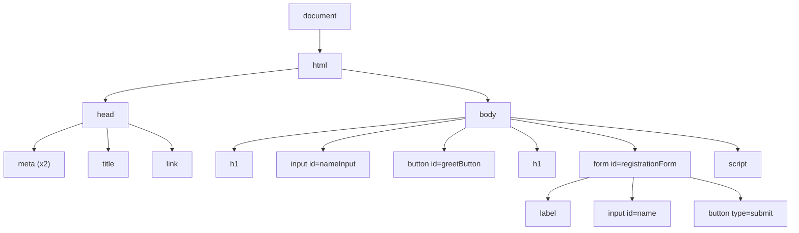

**Page behavior (This code goes inside a file called script.js)**

```javascript
// Function to greet the user
function greetUser() {
    const name = document.getElementById("nameInput").value.trim(); // Get the input value without extra spaces
    if (name) {
        alert(`Hello, ${name}!`); // Show alert with greeting
    } else {
        alert("Please enter your name."); // Alert if the input is empty
    }
}

// Add event listener to the greet button
document.getElementById("greetButton").addEventListener("click", greetUser);

// Add event listener for form submission
document.getElementById("registrationForm").addEventListener("submit", function(event) {
    const nameInput = document.getElementById("name").value.trim(); // Get the name input value
    
    if (!nameInput) {
        event.preventDefault(); // Prevent form submission
        alert("Please enter your name."); // Alert if the input is empty
    } else {
        alert(`Thank you, ${nameInput}, for registering!`); // Show a thank-you message
    }
});
```

Explanation:

- **Getting Elements by ID**: In both examples, we use `document.getElementById()` to access the input fields and buttons by their IDs.
- **Event Listeners**: We attach event listeners to buttons and forms to trigger specific functions when they are clicked or submitted.
- **Input Validation**: The form validation checks if the input field is empty before submitting. If it is, an alert prompts the user to enter their name. Note that the `required` attribute in the HTML already makes the browser block empty submissions, so our JavaScript check mainly catches names made only of spaces (thanks to `.trim()`). Also keep in mind that client-side validation improves the user experience, but it can be bypassed, so any real application must also validate data on the server.

**Other common DOM operations:** Besides `getElementById()`, these are some of the most used DOM methods and properties:

```javascript
// Selecting elements with CSS selectors
const title = document.querySelector("h1");            // First element that matches
const buttons = document.querySelectorAll("button");   // All matching elements (a NodeList)

// Changing content and styles
title.textContent = "Hello, DOM!";      // Change the text of an element
title.classList.add("highlight");       // Add a CSS class
title.style.color = "steelblue";        // Change an inline style

// Creating and inserting a new element
const message = document.createElement("p");
message.textContent = "This paragraph was added with JavaScript.";
document.body.append(message);

// Removing an element
// message.remove();
```

Prefer `textContent` over `innerHTML` when inserting text that comes from users, because `innerHTML` parses the text as HTML, which can open the door to security problems (cross-site scripting, or XSS).

By separating the HTML and JavaScript into different files, we maintain a clean and organized structure that enhances readability and maintainability. This basic approach to DOM manipulation and form validation can be expanded with more complex logic and additional features as needed!

---

### 26. Understanding JavaScript Module Systems

JavaScript module systems are critical for structuring applications, promoting code reusability, and managing dependencies. They provide a way to organize code into self-contained units, making it easier to develop, maintain, and scale applications.

__Module Systems:__ JavaScript has evolved to include several module systems, each designed to meet different needs and environments. Here are the most commonly used module systems:

__1. CommonJS:__

CommonJS is primarily used in Node.js and allows synchronous loading of modules using the `require()` function. Each file in CommonJS is treated as a separate module.

**Example:**

```javascript
// math.js
function add(a, b) {
  return a + b;
}

module.exports = { add }; // Exporting the add function

// main.js
const math = require('./math'); // Importing the module

console.log(math.add(5, 3)); // Output: 8
```

__2. AMD (Asynchronous Module Definition):__

AMD is designed for browser environments and allows for asynchronous loading of modules. It was popular (mainly through the RequireJS library) for managing dependencies in large applications before browsers supported modules natively. Today it is considered legacy, but you may still find it in older projects.

**Example:**

```javascript
// math.js
define([], function() {
  return {
    add: function(a, b) { // Exporting the add function
      return a + b;
    }
  };
});

// main.js
require(['math'], function(math) { // Importing the module
  console.log(math.add(5, 3)); // Output: 8
});
```

__3. UMD (Universal Module Definition):__

UMD is a pattern that works across different environments, including CommonJS, AMD, and global variables. It allows you to create modules that can be loaded in various contexts. Like AMD, it is mostly found in older libraries; you'll rarely need to write it by hand today.

**Example:**

```javascript
// umdMath.js
(function (root, factory) {
  if (typeof define === 'function' && define.amd) {
    define([], factory);
  } else if (typeof exports === 'object') {
    module.exports = factory();
  } else {
    root.umdMath = factory();
  }
}(this, function () {
  return {
    add: function(a, b) { // Exporting the add function
      return a + b;
    }
  };
}));

// main.js
const umdMath = require('./umdMath'); // Importing the module
console.log(umdMath.add(5, 3)); // Output: 8
```

__4. ES Modules (ESM): Creating and Using Modules with Exports:__

ES Modules are the standardized module system in modern JavaScript, supported by both browsers and Node.js. ESM allows for asynchronous loading and uses the `import` and `export` syntax.

**Example:**

```javascript
// math.js
export function add(a, b) { // Exporting the add function
  return a + b;
}

// main.js
import { add } from './math.js'; // Importing the module

console.log(add(5, 3)); // Output: 8
```

With the understanding of ES modules, we can now explore how to create and use modules in JavaScript using the `export` and `import` which have become the standard in modern JavaScript development.

__Enabling ES Modules:__ Before using `import`/`export`, the environment needs to know your file is a module:

- **In the browser**: load the entry file with `<script type="module" src="main.js"></script>` (see Section 24). Note that browsers block modules opened directly from the file system (`file://`), so serve your files through a local server, such as the Live Server extension mentioned in the BONUS section.
- **In Node.js**: either add `"type": "module"` to your `package.json` file, or use the `.mjs` file extension. Without one of these, Node.js treats `.js` files as CommonJS.

| | CommonJS | ES Modules |
|---|---|---|
| Syntax | `require()` / `module.exports` | `import` / `export` |
| Loading | Synchronous | Asynchronous |
| Where | Node.js (traditional default) | Browsers and Node.js (the official standard) |
| Strict mode | Only if enabled | Always on |

#### Module Definition and Exporting:

In ES Modules, you define a module by exporting functions, objects, or variables that you want to make available to other modules. There are two primary types of exports: named exports and default exports.

__Named Exports:__ Named exports allow you to export multiple functions, variables, or objects from a module. Each exported member must be imported by its name.

```javascript
// math.js
export function add(a, b) { // Exporting the add function
  return a + b;
}

export function subtract(a, b) { // Exporting the subtract function
  return a - b;
}
```

We can import these functions in another module like this:

```javascript
// main.js
import { add, subtract } from './math.js'; // Importing named exports

console.log(add(5, 3));        // Output: 8
console.log(subtract(5, 3));   // Output: 2
```

__Default Exports:__ A default export allows you to export a single value or object from a module. We can import a default export without using curly braces.

```javascript
// calculator.js
export default function multiply(a, b) { // Exporting the multiply function as default
  return a * b;
}
```

Importing this function in another module:

```javascript
// main.js
import multiply from './calculator.js'; // Importing the default export

console.log(multiply(4, 2));   // Output: 8
```

Additionally, we can import everything from a module as a single object. Example:

```javascript
// math.js
export function add(a, b) {
  return a + b;
}

export function subtract(a, b) {
  return a - b;
}

// main.js
import * as math from './math.js'; // Importing everything as an object

console.log(math.add(5, 3));       // Output: 8
console.log(math.subtract(5, 3));  // Output: 2
```

Putting the examples above together, the files depend on each other like this, with each arrow showing what one file imports from another:

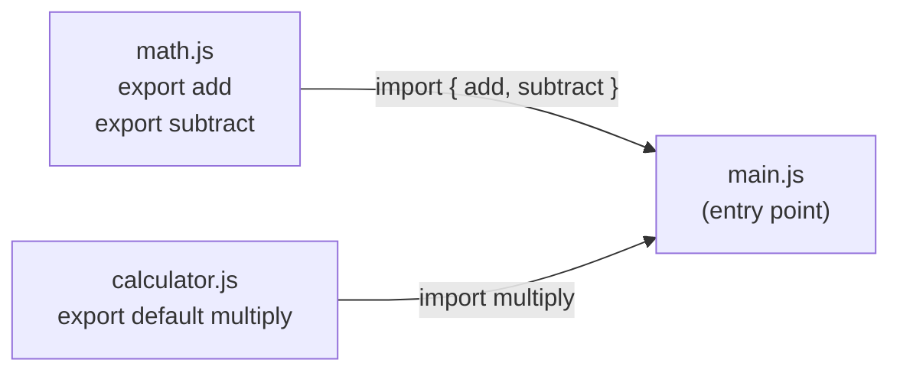

#### Real Benefits of Using Modules

1. **Encapsulation**: Modules help encapsulate functionality, keeping the codebase organized and reducing the risk of conflicts in the global namespace.

2. **Reusability**: Once a module is created, it can be reused across different projects or parts of the application, reducing duplication.

3. **Maintainability**: Changes in one module do not affect others, making it easier to manage large applications and enabling better collaboration among developers.

4. **Dependency Management**: Modules can explicitly declare their dependencies, making it easier to understand the relationships between different parts of the application.

In summary, JavaScript module systems provide a robust framework for organizing and managing code effectively, while ES Modules offer a standardized way to create and use modules with the `export` and `import` syntax. This modular approach enhances code reusability, maintainability, and collaboration, making it an essential aspect of modern JavaScript development.

---

### 27. Understanding Promises, Async-Await, and Their Relationship to Functions

Promises and the `async-await` syntax are essential tools for managing asynchronous operations in JavaScript. They allow developers to write cleaner and more readable code, avoiding the complexity of "callback hell" (deeply nested callbacks) and simplifying error handling.

__Promises:__ A **Promise** is an object representing the eventual completion (or failure) of an asynchronous operation and its resulting value. Promises provide a powerful mechanism for managing asynchronous tasks and allow you to work with asynchronous code in a more structured manner. 

How Promises Work:

1. **Pending**: The initial state of the promise, meaning the operation is still ongoing.
2. **Fulfilled**: The operation completed successfully, and the promise has a resulting value.
3. **Rejected**: The operation failed, and the promise has a reason for the failure.

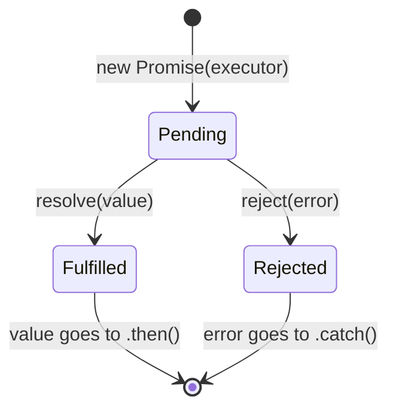

Once a promise is fulfilled or rejected, it is said to be __settled__, and its state can never change again.

To create a promise, we use the Promise constructor, which requires a special function called the "executor". This function runs immediately and provides two parameters that we can use:

- `resolve`: used when the task is successful.  
- `reject`: used when the task fails.  

For example, the `fetchData()` ahead is a function that pretends to fetch data (like from a server). It uses `setTimeout` to act like it's waiting. Depending on a random condition, it either completes successfully (calling `resolve`) or fails (calling `reject`).

```javascript
function fetchData() {
    return new Promise((resolve, reject) => {
        // Simulating an asynchronous operation with a random success/failure outcome
        setTimeout(() => {
            const operationResult = Math.random() > 0.5;

            if (operationResult) {
                const data = { name: "Alice", age: 25 };
                resolve(data); // Resolve with data
            } else {
                reject(new Error("Operation failed!")); // Reject with an Error object
            }
        }, 1000);
    });
}

// Calling 'fetchData', which returns a Promise. The result can be handled using .then() and .catch().
fetchData()
    .then(data => console.log(data)) // Handle the resolved value
    .catch(error => console.error(error.message)); // Handle the rejected value
```

Key Points:

- The function `fetchData()` returns a Promise, which can be in a pending, fulfilled, or rejected state.
- The `.then()` method is used to handle the successful result, while the `.catch()` method is used for error handling.
- Just like with `throw`, it's best practice to reject with an `Error` object rather than a plain string.

__Asynchronous code doesn't block:__ It's important to understand that JavaScript doesn't stop and wait for a promise to settle. The rest of the code keeps running, and the `.then()` callback runs later, once the result is available:

```javascript
console.log("1. Before calling fetchData");

fetchData()
    .then(data => console.log("3. Data received:", data))
    .catch(error => console.error("3. Failed:", error.message));

console.log("2. After calling fetchData"); // Runs BEFORE the promise settles
```

__Async-Await:__ The `async-await` syntax provides a more intuitive way to work with Promises, allowing you to write asynchronous code that looks and behaves more like synchronous code. This is particularly useful for making your code easier to read and maintain.

How Async-Await Works:

- An `async` function always returns a Promise. If the function returns a value, that value is wrapped in a resolved Promise. If an error is thrown, the Promise is rejected.
- The `await` keyword can be used inside an `async` function (or at the top level of an ES module). It pauses the execution of that function until the Promise is resolved or rejected, simplifying the flow of asynchronous code. Other code outside the function keeps running in the meantime.

In the example below, the function `fetchDataAsync()` is declared as `async`. Within this function, we can use `await` to pause execution until `fetchData()` resolves or rejects.

```javascript
async function fetchDataAsync() {
    try {
        // Wait for fetchData to resolve; execution pauses here until the promise is settled.
        const data = await fetchData(); 
        console.log(data); // Log the resolved value
    } catch (error) {
        console.error(error.message); // Handle any error that occurs during the asynchronous operation
    }
}

// Invoking the async function
fetchDataAsync();
```

**Key Points:**

- The `async` keyword is essential when using `await` within a function.
- Using `await` allows us to write asynchronous code in a way that resembles synchronous flow, enhancing readability and maintainability.
- Errors in the asynchronous code can be caught using `try-catch` blocks, making error handling straightforward.

__Running promises in parallel:__ Using `await` one after another runs the operations in sequence. When operations don't depend on each other, `Promise.all()` lets them run at the same time and waits until all of them are fulfilled (or until the first one is rejected):

```javascript
async function loadTwoUsers() {
    try {
        const [first, second] = await Promise.all([fetchData(), fetchData()]);
        console.log(first, second);
    } catch (error) {
        console.error("At least one operation failed:", error.message);
    }
}

loadTwoUsers();
```

__A real-world example with `fetch()`:__ Our `fetchData()` only simulates a request, but browsers and Node.js (version 18 and later) include the built-in `fetch()` function, which makes real HTTP requests and returns a Promise:

```javascript
async function getTodo() {
    try {
        const response = await fetch("https://jsonplaceholder.typicode.com/todos/1");

        if (!response.ok) {
            throw new Error(`HTTP error! Status: ${response.status}`);
        }

        const todo = await response.json(); // Parsing the body is also asynchronous
        console.log(todo.title);
    } catch (error) {
        console.error("Request failed:", error.message);
    }
}

getTodo();
```

Promises and `async-await` are fundamental concepts in JavaScript that streamline the management of asynchronous operations. Promises allow for a structured approach to handling asynchronous tasks, while `async-await` offers a more natural, synchronous-looking syntax for working with Promises. By leveraging these features, developers can write cleaner, more efficient code while effectively managing errors and improving overall code quality.

---

### 28. Declarative vs. Imperative Programming and Immutability in JavaScript

#### Commonly used paradigms:

__1) Declarative programming:__ This programming paradigm focuses on *what* the program should accomplish rather than *how* to accomplish it. In JavaScript, declarative programming often manifests in functions, such as using array methods like `.map()`, `.filter()`, and `.reduce()`, which express the desired outcome without detailing the control flow or state changes. Example of Declarative Programming:

```javascript
const numbers = [1, 2, 3, 4, 5];

// Using declarative style with .map() to create a new array with squared values
const squared = numbers.map(num => num * num);
console.log(squared); // Output: [1, 4, 9, 16, 25]
```

In this example, we declare our intention to transform an array of numbers into their squares without explicitly iterating through the array.

__2) Imperative Programming:__ In contrast, imperative programming involves giving explicit instructions on how to achieve a desired outcome. This paradigm focuses on the sequence of statements to change the program's state. Example:

```javascript
const numbers = [1, 2, 3, 4, 5];
const squared = [];

// Using imperative style with a for loop to square each number
for (let i = 0; i < numbers.length; i++) {
    squared[i] = numbers[i] * numbers[i];
}
console.log(squared); // Output: [1, 4, 9, 16, 25]
```

In this example, we explicitly define how to loop through the array and update the results.

__3) Immutability:__ Refers to the concept of data that cannot be changed after it is created. In JavaScript, immutability is often associated with functional programming and helps to avoid unintended behavior. Instead of modifying existing data structures, developers create new ones.

**Example of Immutability:**

```javascript
const originalArray = [1, 2, 3];

// Using map to create a new array instead of modifying the original
const newArray = originalArray.map(num => num * 2);

console.log(originalArray); // Output: [1, 2, 3]
console.log(newArray); // Output: [2, 4, 6]
```

Here, `originalArray` remains unchanged, while `newArray` is a new array that reflects the transformation, demonstrating immutability.

Some array methods, like `push()`, `sort()`, and `reverse()`, change (mutate) the original array. Here are common immutable alternatives that create new arrays and objects instead:

```javascript
const scores = [30, 10, 20];

// Adding an item: instead of scores.push(40)
const withNewScore = [...scores, 40];             // [30, 10, 20, 40]

// Sorting: instead of scores.sort(), use toSorted() (ES2023)
const sortedScores = scores.toSorted((a, b) => a - b); // [10, 20, 30]

// Removing an item: instead of scores.splice(...)
const withoutTen = scores.filter(score => score !== 10); // [30, 20]

console.log(scores); // [30, 10, 20] (the original is untouched)

// Updating an object property: instead of user.age = 26
const user = { name: "Alice", age: 25 };
const olderUser = { ...user, age: 26 };

console.log(user.age);      // 25
console.log(olderUser.age); // 26
```

In summary we have:

- **Declarative programming** focuses on *what* to achieve, providing higher-level abstractions and enhancing code readability.
- **Imperative programming** emphasizes *how* to achieve results through explicit instructions, often leading to more complex code.
- **Immutability** ensures that data structures remain unchanged, promoting predictable behavior and reducing side effects, which is particularly valuable in functional programming paradigms.

---

### Proposed exercises and answers

##### 1. Type Conversion

Create a variable `numString` with the string value "123". Convert this string to a number and multiply it by 10. Log the result.

**Tip**: Use the built-in JavaScript function that can convert strings to numbers.

##### 2. Conditional Statement

Write a program that checks if a number stored in a variable `x` is positive or negative. Print "Positive" if it is greater than 0, otherwise print "Negative".

##### 3. Loop to Sum Numbers

Write a loop that sums all numbers from 1 to 100 and prints the result.

**Tip**: Use a `for` loop to iterate over numbers from 1 to 100 and keep a running total.

##### 4. Switch-Case Statement

Create a program that takes a variable `day` (with values from 1 to 7) and prints the corresponding day of the week (1 = "Monday", 2 = "Tuesday", etc.).

**Tip**: Use a `switch` statement to map each number to a day of the week.

##### 5. Function to Convert Temperature

Write a function `convertToFahrenheit` that takes a temperature in Celsius as an argument and returns the equivalent temperature in Fahrenheit. Use the formula: `F = C * 9/5 + 32`.

**Tip**: The function should accept one argument and return a value.

##### 6. String Manipulation

Write a program that takes a sentence as input, splits it into words, and logs each word separately in uppercase.

**Tip**: Use JavaScript string methods like `split()` and `toUpperCase()`.

##### 7. Scope and Hoisting

Predict and explain the output of the following code snippet. Then, modify the code so that using `a` before its declaration throws an error, instead of silently logging `undefined`.

```javascript
function test() {
    console.log(a);  // What will be logged here?
    var a = 10;
    console.log(a);  // What will be logged here?
}

test();
```

**Tip**: Review the differences between `var` and `let` in Section 13.

##### 8. Array Methods

Given the array `const prices = [12, 45, 7, 30, 18];`, keep only the prices greater than 15, apply a 10% discount to each of them, and calculate the total of the discounted prices. Log the total with two decimal places.

**Tip**: Chain `.filter()`, `.map()`, and `.reduce()`, and remember `.toFixed()` from Section 15.

##### 9. Objects and Destructuring

Create an object `book` with the properties `title`, `author`, and `year`. Use destructuring to extract `title` and `author`, and log a message like `"Clean Code by Robert C. Martin"` using a template literal. Then create a new object `updatedBook` with a different `year`, without modifying the original `book`.

**Tip**: Use the spread syntax (`...`) to copy the object.

##### 10. Promises and Async-Await

Write a function `wait(ms)` that returns a Promise which resolves after `ms` milliseconds. Then write an `async` function that logs "Start", waits for 1 second using `wait()`, and then logs "Done".

**Tip**: Use `setTimeout` inside the Promise executor, and `await` inside the `async` function.

#### Answers (Try to solve yourself before checking these solutions)

```javascript
// 1. Type Conversion
const numString = "123";
console.log(Number(numString) * 10);

// 2. Conditional Statement
const x = 5; 
console.log(x > 0 ? "Positive" : "Negative");

// 3. Loop to Sum Numbers
let sum = 0;
for (let i = 1; i <= 100; i++) {
    sum += i;
}
console.log(sum);

// 4. Switch-Case Statement
const day = 3; 
switch(day) {
    case 1: console.log("Monday"); break;
    case 2: console.log("Tuesday"); break;
    case 3: console.log("Wednesday"); break;
    case 4: console.log("Thursday"); break;
    case 5: console.log("Friday"); break;
    case 6: console.log("Saturday"); break;
    case 7: console.log("Sunday"); break;
    default: console.log("Invalid day");
}

// 5. Function to Convert Temperature
function convertToFahrenheit(celsius) {
    return celsius * 9 / 5 + 32;
}
console.log(convertToFahrenheit(30));

// 6. String Manipulation
const sentence = "JavaScript is a versatile language"; 
const words = sentence.split(" ");
for (let word of words) {
    console.log(word.toUpperCase());
}

// 7. Scope and Hoisting
function test() {
    console.log(a);  // Logs 'undefined': the 'var a' declaration is hoisted, but not its value
    var a = 10;      
    console.log(a);  // Logs 10 because 'a' has been assigned a value by this point
}
test();

function testWithLet() {
    // console.log(a); // Uncommenting this line throws: ReferenceError: Cannot access 'a' before initialization
    let a = 10;        // 'let' is hoisted too, but stays in the Temporal Dead Zone until this line
    console.log(a);    // Logs 10
}
testWithLet();

// 8. Array Methods
const prices = [12, 45, 7, 30, 18];
const total = prices
    .filter(price => price > 15)              // [45, 30, 18]
    .map(price => price * 0.9)                // [40.5, 27, 16.2]
    .reduce((sum, price) => sum + price, 0);  // 83.7
console.log(total.toFixed(2)); // "83.70"

// 9. Objects and Destructuring
const book = { title: "Clean Code", author: "Robert C. Martin", year: 2008 };
const { title, author } = book;
console.log(`${title} by ${author}`);

const updatedBook = { ...book, year: 2025 };
console.log(book.year);        // 2008 (original unchanged)
console.log(updatedBook.year); // 2025

// 10. Promises and Async-Await
function wait(ms) {
    return new Promise(resolve => setTimeout(resolve, ms));
}

async function run() {
    console.log("Start");
    await wait(1000);
    console.log("Done");
}
run();
```

---

### BONUS - Running JavaScript on your machine (using Node.js)

When you install Node.js on your computer, it essentially enables you to use JavaScript to communicate with your system directly. This means you can do things like automate tasks, create servers, manage files, and interact with databases using JavaScript. It expands the reach of JavaScript beyond just web browsers, allowing you to tap into the full potential of the language on your machine. Let's now delve into how we can harness JavaScript's power on our machines with the assistance of Node.js.

1. __Installing Node.js__

To get started with Node.js, follow these steps:

a. Navigate to the official Node.js website at __nodejs.org__.

b. Click on the download button to access the suitable version of Node.js for your operating system (Windows, macOS, or Linux). You'll have the choice between the LTS (Long-Term Support) version, offering the most recent stable release and recommended for most users, and the version with the latest features, suitable for experimental, advanced, or specific needs.

c. Once the download is complete, run the installer and follow the on-screen instructions to install Node.js on your computer.

d. During the installation process, ensure to include the option to add Node.js to your system's PATH. This will make it easier to run Node.js commands from the terminal.

e. After installation, open the terminal (Command Prompt on Windows, Terminal on macOS and Linux) and type ```node --version``` to confirm that Node.js was installed correctly and to check the version.

Now, you can execute Node.js scripts directly from the command line using the node command. This will launch the Node.js interpreter, denoted by the > prompt. From here, you can execute JavaScript commands. For instance, typing console.log('Hello, Node.js!') will output 'Hello, Node.js!' in the terminal. To exit the Node.js interpreter, type ```.exit```, press ```Ctrl + D```, or press ```Ctrl + C``` twice.

2. __Installing Visual Studio Code and Essential Plugins for JavaScript Development__

Visual Studio Code (VS Code) is a powerful code editor developed by Microsoft, known for its versatility and lightweight design. To install VS Code, visit __code.visualstudio.com__, download and run the installer for your operating system, then follow the on-screen instructions to complete the installation process.

Essential VS Code Plugins for JavaScript Development:

__ESLint (by Microsoft):__ ESLint is the most widely used linter for JavaScript. It analyzes your code as you type and highlights likely bugs and bad practices, such as unused variables, variables used before being defined, or accidental use of ```==``` instead of ```===```. The extension uses the ESLint library installed in your project, so you'll also need to set it up there (for example, by running ```npm init @eslint/config@latest```).

__Prettier (by Prettier):__ Prettier is a versatile code formatter that supports various languages like JavaScript, HTML, CSS, TypeScript, JSON, Markdown, and more. It can be used directly within code editors with extensions, through command-line tools, as pre-commit hooks in version control systems, or integrated into build tools and CI pipelines. Its purpose is to automate code formatting, ensuring consistency and readability across projects.

__Path Intellisense (by Christian Kohler):__ Path Intellisense offers autocomplete functionality for file paths within import statements and HTML src attributes, aiding in efficient navigation within your project. Its suggestions are automatically populated after installing the plugin, helping you save time by accurately predicting file paths as you type.

__Live Server (by Ritwick Dey):__ Live Server launches a local development server with live reload functionality for HTML, CSS, and JavaScript files. This tool is typically used to create a local server for running front-end projects, especially when JavaScript code is associated with HTML files. Its usage is extremely simple: just right-click on the index.html file (for example) and select 'Open with Live Server'.

__JavaScript (ES6) code snippets (by charalampos karypidis):__ Provides a collection of ES6 code snippets for faster coding. For example, once it is installed, we can type ```mde``` and hit TAB so it will generate the code snippet ```module.exports = { };```

__Code Spell Checker(by Street Side Software)__:  This extension helps maintain clean and error-free code by highlighting spelling mistakes in comments and strings. It assists in avoiding typos and ensuring code professionalism.

General Configuration: Visual Studio Code allows you to customize settings, keybindings, and themes to suit your preferences. Explore the various features provided by VS Code and its plugins to enhance your JavaScript development experience.

3. __Automatic code formatting with Prettier__

To enable automatic code formatting with Prettier upon saving JavaScript files, create a folder named __.vscode__ in the root directory of your project. Inside this folder, include a file named __settings.json__ with the following configuration:

```json
{
  "[javascript]": {
    "editor.defaultFormatter": "esbenp.prettier-vscode",
    "editor.formatOnSave": true
  }
}
```

Once configured, you'll notice that your JavaScript code is automatically formatted according to Prettier's rules whenever you save a file. This includes consistent indentation, proper spacing, and other style guidelines, leading to cleaner and more maintainable code. These automated adjustments streamline your development process, eliminating the need for manual formatting and ensuring code consistency across your projects. To customize Prettier's rules, you can create a __.prettierrc__ file in your project's root directory. This file allows you to specify your preferred formatting rules for Prettier. Here's an example of a .prettierrc file:

```json
{
  "singleQuote": true,
  "semi": true,
  "tabWidth": 2,
  "printWidth": 100
}
```

In this example: __"singleQuote"__ Configures Prettier to use single quotes instead of double quotes for strings. __"semi"__ specifies whether to add semicolons at the end of statements. __"tabWidth"__ sets the width of a tab character. __"printWidth"__ specifies the maximum number of characters per line before code is wrapped. 

To explore more options and documentation for Prettier, you can visit __prettier.io__

4. __Running Javascript code with Node.js capabilities__

With Visual Studio Code open, navigate to the desired folder (where your project will be), right-click, and select 'New File'. Name it with a .js extension (e.g., __scripts.js__). Inside this file, you can write your JavaScript code, like the following:

```javascript
const num1 = 10;
const num2 = 20;
const result = num1 + num2;
console.log(`The sum of ${num1} and ${num2} is: ${result}`);
```

Once you're in the directory containing your JavaScript file, you can run it using Node.js. Open your terminal, navigate to the directory, and type ```node scripts.js```. This command will execute your JavaScript file and display the output in the terminal. 

Node.js comes with a built-in module called File System (fs), which enables various operations such as dealing with the file system. For instance, if we want to create a .txt file and write to it, we can use the __fs__ module. It provides a way to write to a file while passing a function to handle possible errors. The __fs__ module in Node.js stands for "file system" and allows performing operations like reading from and writing to files, creating directories, deleting files, and more. As one of the core modules in Node.js, it comes pre-installed and doesn't need separate installation via a package manager. In Node.js, we use the ```require``` function to include modules in JavaScript files. When we use ```require('module_name')```, Node.js searches for the specified module in the file system, loads and evaluates it, and returns its exported object. The ```require``` function is part of the CommonJS module system, specifically designed for server-side JavaScript environments like Node.js, where modules are loaded synchronously. With this knowledge, we are fully capable of understanding, writing, and expanding upon code such as the following:

```javascript
// loads the "file system" module
const fs = require('fs');

// Define the file name
const fileName = 'example.txt';

// Text to be written to the file
const textToWrite = 'Hello, world! This is some text written to a file using Node.js.';

// Write to the file
fs.writeFile(fileName, textToWrite, (err) => {
    if (err) {
        console.error('Error writing to file:', err);
    } else {
        console.log('File successfully created and text written.');
    }
});
```

This code loads the built-in "file system" module (fs) in Node.js, defines a file name as example.txt, prepares a string containing some text, writes the content of the string to the file specified by fileName, and logs either an error or success message based on the writing process.

The same task can also be written with the more modern tools covered in Sections 26 and 27: ES modules and ```async-await```. The ```fs/promises``` module offers Promise-based versions of the file system functions, and the ```node:``` prefix makes it explicit that we're loading a built-in Node.js module. Save it as __scripts.mjs__ (the ```.mjs``` extension tells Node.js to treat the file as an ES module) and run it with ```node scripts.mjs```:

```javascript
import { writeFile, readFile } from 'node:fs/promises';

const fileName = 'example.txt';

try {
    await writeFile(fileName, 'Hello, world! Written with async-await.');
    const content = await readFile(fileName, 'utf8');
    console.log('File content:', content);
} catch (err) {
    console.error('Error working with the file:', err.message);
}
```

Note that ```await``` is used here at the top level of the file, outside any function. That is allowed because the file is an ES module. To learn more about what can be done with Node.js, including its built-in modules like "file system" (fs), you can refer to the official Node.js documentation available on their website: __https://nodejs.org/docs/latest/api__. Additionally, there are various tutorials, courses, and online resources dedicated to learning Node.js that can provide comprehensive information on its capabilities and usage.

5. __Understanding Node Package Manager (npm)__

Node Package Manager (npm) is a powerful tool used to manage JavaScript packages and dependencies for Node.js projects. npm is the default package manager for Node.js and JavaScript projects. It allows developers to easily install, publish, and manage packages and dependencies for their Node.js projects. These packages contain reusable JavaScript code, libraries, frameworks, and tools that enhance development productivity and extend the functionality of Node.js applications.

Benefits of Using npm:

* Efficient Dependency Management: npm simplifies the process of managing dependencies by automatically installing and updating packages required for your project.

* Large Package Repository: npm provides access to a vast repository of packages, offering a wide range of functionality for various development needs.

* Version Control: npm allows developers to specify and manage package versions, ensuring consistency and compatibility across projects.

* Community Support: Many npm packages are actively maintained by the open-source community, providing continuous improvements, bug fixes, and support.

* Integration with Build Tools: npm integrates seamlessly with popular build tools and task runners like webpack, Gulp, and Grunt, enhancing the development workflow.

Installation of npm: npm typically comes bundled with Node.js installation. When you install Node.js on your computer, npm is automatically installed along with it. Therefore, to install npm, you need to install Node.js first.

6. __Installing and managing dependencies__

Before installing packages, initialize your project by running ```npm init -y``` in your project directory. This creates a __package.json__ file with default values (the ```-y``` flag accepts all the defaults, so you aren't asked any questions). This file describes your project and lists its dependencies and scripts.

To install an npm package, open your terminal or command prompt, navigate to your project directory, and run the command ```npm install <package-name>```. For example, to install a popular 
JavaScript utility library called __lodash__, consider running ```npm install lodash``` or simply ```npm i lodash```. So we have some things to consider:

__Associated files and folders:__ npm automatically manages dependencies for your project by recording every installed package and its version range in the __package.json__ file. You can also specify dependencies manually in this file and use npm install to install them. The __package-lock.json__ file is created by npm to lock down the exact version of each package and its dependencies installed in a project. It ensures consistency across different installations by guaranteeing that everyone working on the project uses the same versions of dependencies. This file is automatically generated and updated whenever npm installs or updates packages in the project. The __node_modules__ folder is where npm installs project dependencies. It contains all the packages and their dependencies specified in the package.json file. Each installed package is stored in its own folder within node_modules, ensuring that the project has access to the required modules. This folder is automatically created and managed by npm when packages are installed using commands like npm install. It's essential for storing and organizing all the external libraries and modules used in a Node.js project.

Here's how a single install command affects each of them:

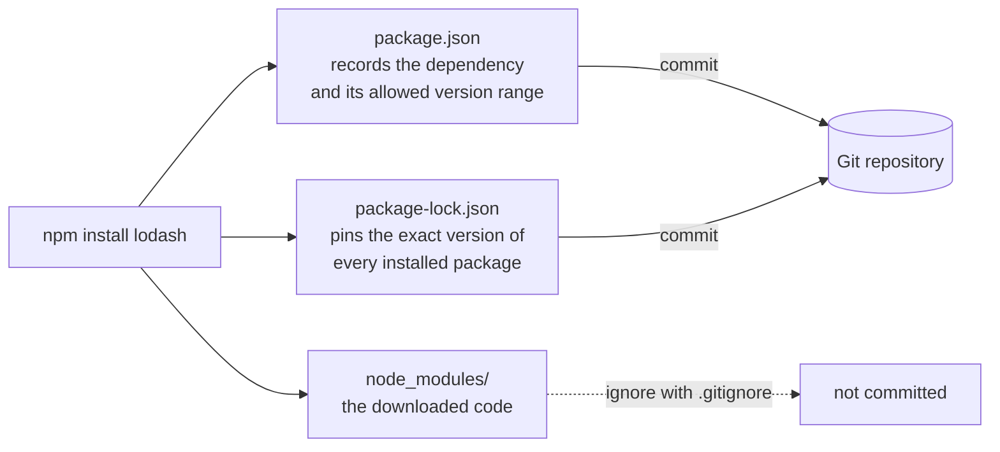

Note: When uploading your project to GitHub, it's crucial to ignore the 'node_modules' folder. Other developers can re-download this folder on their machines. To do that, create a file named __.gitignore__ in the root of your project containing the line ```node_modules/```. Additionally, ensure to upload both __package.json__ and __package-lock.json__ files, as they specify the library versions required for the project.

__Using installed packages:__ After installing a package, you can import and use it alongside your JavaScript code. For example, if you installed lodash, you can import it using ```require('lodash')``` for example. With your __scripts.js__ file you can test the installation and usage of lodash with the following code:

```javascript
const _ = require('lodash');

// Sample array
const numbers = [1, 2, 3, 4, 5];

// Double each element using lodash map
const doubledNumbers = _.map(numbers, num => num * 2);

// Output the result
console.log(doubledNumbers); // Output: [2, 4, 6, 8, 10]
```

To manage our dependencies we want to consider some key aspects:

__Installing packages for Development:__ When you install a package with the ```--save-dev``` flag or the ```-D``` shorthand, npm adds the package to your __devDependencies__ inside the __package.json__ file. These dependencies are only required for development or testing purposes, not for running the application in a production environment. For instance, if you install a testing framework like Mocha with ```npm i mocha -D```, it will be listed under devDependencies because it's only needed during development, not when deploying the application to a production server. 

Note: Since npm v5, ```npm install <package-name>``` saves the package to the __dependencies__ section of package.json by default. You'll still see the ```--save``` flag (as in ```npm i lodash --save```) in older tutorials, but it is no longer necessary.

__Uninstalling dependencies:__ We can uninstall dependencies using ```npm uninstall <package-name>``` or ```npm uninstall <package-name1> <package-name2> <package-name3>``` for multiple dependencies. When using ```npm uninstall <package-name>```, npm removes the package from both the node_modules directory and the package.json file by default. 

__Listing installed dependencies:__ You can check all installed packages and their versions by running the command ```npm list```.

With npm, we can incorporate libraries to run alongside our project's automated processes. For example, we can download a specific library and use it as our code linter by running ```npm run lint```. While configuring this type of usage is beyond the scope of this tutorial, it's not difficult to set up and plenty of examples can be found online. Additionally, you can use ```npm help``` to discover more commands enabled by npm. By leveraging npm, you can streamline your Node.js development process, efficiently manage project dependencies, and access a vast ecosystem of JavaScript packages and tools.

7. __Using Yarn or other package managers__

npm is not the only package manager for JavaScript. Yarn, originally created at Facebook in 2016, became popular for its speed and for introducing a lockfile that guaranteed consistent installations at a time when npm didn't have one. Since then, npm has adopted many of the same ideas (such as ```package-lock.json``` and workspaces), so the differences are smaller today. Another popular option is __pnpm__, which stores each package version only once on your disk and links it into your projects, saving a lot of space and time when you have many projects.

| | npm | Yarn | pnpm |
|---|---|---|---|
| Installation | Comes bundled with Node.js | Installed separately | Installed separately |
| Lockfile | ```package-lock.json``` | ```yarn.lock``` | ```pnpm-lock.yaml``` |
| Install all dependencies | ```npm install``` | ```yarn``` | ```pnpm install``` |
| Add a package | ```npm install <pkg>``` | ```yarn add <pkg>``` | ```pnpm add <pkg>``` |
| Add a dev dependency | ```npm install <pkg> -D``` | ```yarn add <pkg> --dev``` | ```pnpm add <pkg> -D``` |
| Remove a package | ```npm uninstall <pkg>``` | ```yarn remove <pkg>``` | ```pnpm remove <pkg>``` |
| Run a script | ```npm run <script>``` | ```yarn <script>``` | ```pnpm <script>``` |
| Workspaces (monorepos) | Yes (since v7) | Yes | Yes |

All three read the same __package.json__ file and download packages from the same npm registry, so the choice mostly comes down to speed, disk usage, and team preference. The important rule is to pick __one__ per project and stick to it, since each one creates its own lockfile.

Installing and using Yarn:

The simplest way to install Yarn is globally through npm, by running ```npm install -g yarn```. Note that this installs "Yarn Classic" (version 1), which is still widely used. Newer Yarn versions (2 and later) are usually set up per project; check __yarnpkg.com__ for the currently recommended installation method. Once installed, you can use Yarn commands in your terminal, such as ```yarn add <package_name>``` to install a package, ```yarn remove <package_name>``` to uninstall, ```yarn upgrade <package_name>``` to update a package, and ```yarn run <script_name>``` to execute custom scripts from your package.json file.

Ps. Don't confuse these with operating-system package managers, such as __winget__ or __Chocolatey__ on Windows and __Homebrew__ on macOS. Those are used to install programs on your computer (they can even install Node.js itself), not to manage the dependencies of a JavaScript project.

Furthermore, it's crucial to recognize that technology continually evolves, leading to the emergence of new tools with enhanced features. Thus, remaining open to such advancements ensures staying abreast of the latest tools and practices in software development.

8. __Adding 'hot reload' with the help of nodemon__

Consider a scenario where you aim to use Yarn and automate the execution of your JavaScript code every time you save a file. Initially, you need to install Yarn globally using the command ```npm install -g yarn```. Next, install a package that monitors file changes and triggers execution using Node.js. You can achieve this by adding nodemon as a development dependency with ```yarn add nodemon -D```. Once the necessary dependencies are installed, configure a 'start' script in your package.json file to watch and execute your scripts upon saving. This can be done by adding a 'scripts' entry to package.json:

```json
"scripts": {
  "start": "nodemon scripts.js"
}
```

Here's where the 'magic' happens: running ```yarn start``` (or ```npm start```, if you're using npm). From now on, any changes made to scripts.js and saved will automatically trigger our code to rerun. Pretty neat, right? To stop watching, simply navigate to the terminal and press Ctrl + C.

Ps. Modern versions of Node.js also include a built-in watch mode, so for simple cases you don't need any extra package: just run ```node --watch scripts.js```. Nodemon is still useful when you need more control, such as watching specific folders or file types.

9. __Installing and Managing Multiple Versions of Node.js with NVM__

In certain scenarios, managing multiple projects with varying Node.js versions can become cumbersome. Reinstalling different Node.js versions or manually updating environment variables for each project switch isn't practical. To address this challenge, tools like Node Version Manager (nvm) provide a solution by simplifying the installation and usage of any Node.js version released to date. Hence, we can explore:

__Installing NVM on Windows:__ Download and run the NVM installer for Windows from the following link: __https://github.com/coreybutler/nvm-windows/releases__. Look for an installer like __nvm-setup.exe__ and proceed with the installation as usual.

__Installing NVM on Linux:__ Visit the NVM project on GitHub: __https://github.com/nvm-sh/nvm__. Follow the instructions in the README file to get the commands for the installation of the latest NVM version.

After the installation, you can verify the NVM Version by running ```nvm --version```. Keep in mind that these are two different projects, so a few commands differ between them:

| Task | nvm (Linux / macOS) | nvm-windows |
|---|---|---|
| Install the latest LTS version | ```nvm install --lts``` | ```nvm install lts``` |
| Install the latest version | ```nvm install node``` | ```nvm install latest``` |
| Install a specific version (e.g. 22) | ```nvm install 22``` | ```nvm install 22``` |
| Switch to a specific version | ```nvm use 22``` | ```nvm use 22``` |
| Uninstall a specific version | ```nvm uninstall 22.11.0``` | ```nvm uninstall 22.11.0``` |
| List installed versions | ```nvm ls``` | ```nvm list``` |
| Set the default version for new terminals | ```nvm alias default 22``` | Not needed: ```nvm use``` applies globally |

You can always check the active Node.js and npm versions with ```node -v``` and ```npm -v```. In the list of installed versions, the currently active one is marked with an asterisk (or an arrow).

Tip: Prefer the __LTS (Long-Term Support)__ versions for your projects, since they receive bug fixes and security updates for a longer period. You can check the release schedule at __nodejs.org__.

Note (nvm-windows): If the ```nvm use``` command has never been run, no version will be active, even if Node.js has already been installed through nvm.

10. __Documenting shareable projects that use Node.js__

If you intend to upload or share your project on a Git platform, you should instruct others to:

* Download or clone the project repository
* Ensure that Node.js is installed on their machines, which also includes npm
* Install Yarn or any other package manager if the project does not use npm
* Install the dependencies listed in the package.json file. For example, by running ```npm install``` for npm or ```yarn``` for Yarn (with npm, ```npm ci``` is a stricter alternative that installs exactly the versions in package-lock.json, commonly used in automated environments)
* Launch the project. If scripts are not defined in the package.json file, the project is typically executed with ```node <script_name>.js```. However, if a 'start' script is configured and Yarn is being used, the project can be started with the ```yarn start``` command